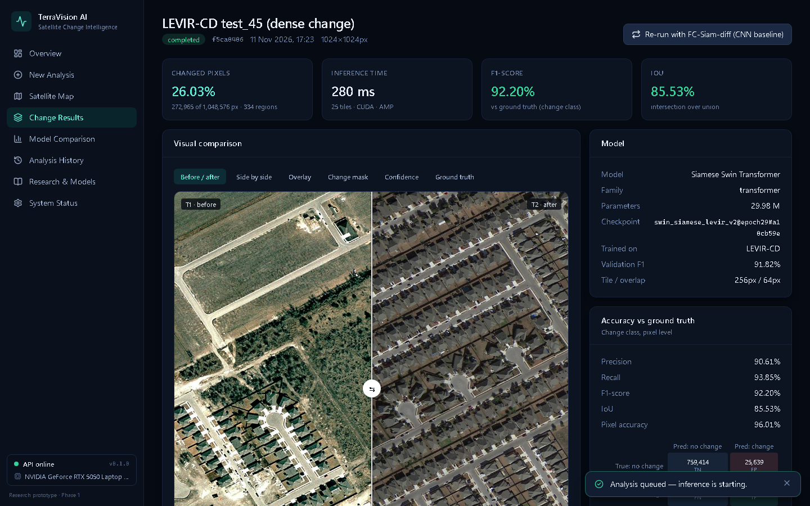
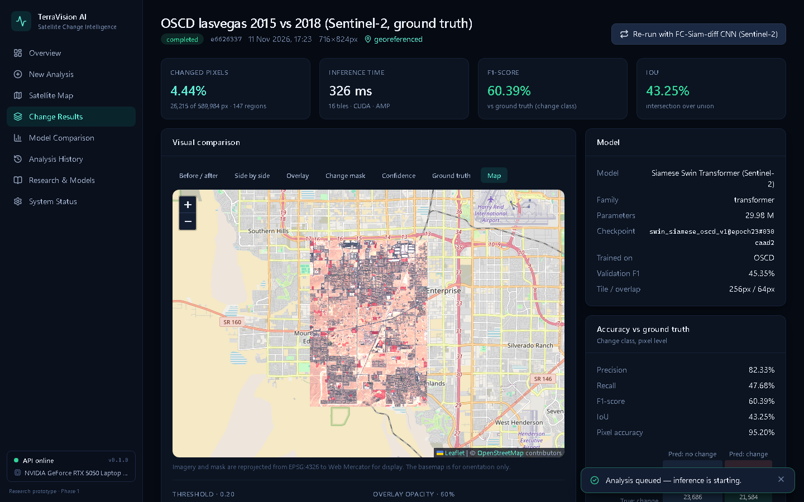
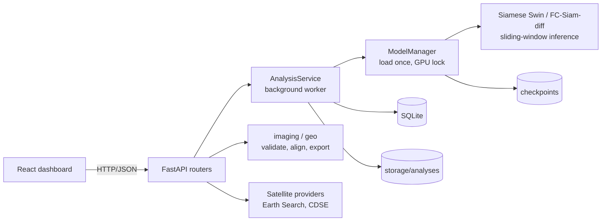

# TerraVision AI - Satellite Change Intelligence

**Vision Transformers for Satellite Land-Use Monitoring** - Phase 1 research prototype.

TerraVision AI detects where land use has changed between two satellite images. A **Siamese Swin Transformer**
predicts a pixel-level change mask and is benchmarked against a **CNN baseline (FC-Siam-diff)** on the same
held-out data, for very-high-resolution aerial imagery (LEVIR-CD, 0.5 m) and for real **Sentinel-2** imagery
(OSCD, 10 m). A FastAPI backend and a React dashboard make it usable: upload or fetch an image pair from a map,
run GPU inference, inspect the change, compare with ground truth, and export georeferenced results.



## Results (held-out test data)

| Test data | Model | F1 | IoU | Precision | Recall |
|---|---|---|---|---|---|
| LEVIR-CD (0.5 m, 2048 patches) | **Siamese Swin Transformer** | **91.35%** | **84.07%** | 92.45% | 90.27% |
| LEVIR-CD (0.5 m) | FC-Siam-diff CNN | 77.89% | 63.79% | 90.53% | 68.35% |
| OSCD Sentinel-2 (10 m, 10 cities) | **Siamese Swin Transformer (S2)** | **47.09%** | **30.80%** | 66.85% | 36.35% |
| OSCD Sentinel-2 (10 m) | FC-Siam-diff CNN (S2) | 39.70% | 24.77% | 55.89% | 30.79% |

A model trained only on 0.5 m LEVIR-CD scores F1 0.00%
on the Sentinel-2 test cities - which is why separate Sentinel-2 models exist. Single training run per model
(seed 42) on an NVIDIA GeForce RTX 5050 Laptop GPU. Details: [docs/MODELS.md](docs/MODELS.md).



## Features

- **Three input modes:** upload two images (PNG, JPEG, GeoTIFF) with an optional ground-truth mask; bundled
  samples with provenance; or search a place, draw an area and retrieve Sentinel-2 scenes (Earth Search).
- **Validation:** file type, integrity, size, channels, dimension and CRS checks; GeoTIFFs on different grids
  are reprojected; unrelated pairs are flagged.
- **Inference:** four trained models, automatic choice of the model that matches the imagery, sliding-window
  inference with mixed precision on GPU (CPU fallback), background jobs.
- **Results:** before/after slider, overlay, change mask, confidence map, error map vs ground truth,
  precision / recall / F1 / IoU / confusion matrix (only with ground truth), threshold and opacity controls.
- **Geospatial:** GeoTIFF mask, GeoJSON change regions, geodesic changed area, results on an interactive map.
- **Research:** model comparison dashboard with both benchmarks and the domain-shift table, analysis history,
  system status.

## Architecture



All seven diagrams (system architecture, flowchart, use-case, class, sequence, DFD level 0 and 1):
[docs/ARCHITECTURE.md](docs/ARCHITECTURE.md).

## Quick start (Windows)

Requirements: Python 3.12, Node.js 20+, optionally an NVIDIA GPU (RTX 50-series needs CUDA 12.8 wheels).

```powershell
git clone https://github.com/aadie14/terravision-ai.git; cd terravision-ai
py -3.12 -m venv .venv
.\.venv\Scripts\python.exe -m pip install torch torchvision --index-url https://download.pytorch.org/whl/cu128
.\.venv\Scripts\python.exe -m pip install -r requirements.txt
cd frontend; npm install; cd ..
```

**Model checkpoints** are not stored in git (the Swin file is 120 MB). Download the four `.pt` files from the
[Phase 1 release](https://github.com/aadie14/terravision-ai/releases/tag/v0.1.0-phase1) into `checkpoints/` (checksums in `SHA256SUMS.txt`), or re-train them (see [docs/Implementation_Guide.md](docs/Implementation_Guide.md)).

```powershell
.\scripts\start.ps1        # backend on :8000, frontend on :5173, opens the browser
```

Then follow the demonstration script in [docs/Implementation_Guide.md](docs/Implementation_Guide.md#8-demonstration).

## Reproduce training and evaluation

```powershell
.\.venv\Scripts\python.exe -m ml.data.download ; .\.venv\Scripts\python.exe -m ml.data.prepare
.\.venv\Scripts\python.exe -m ml.data.oscd download ; .\.venv\Scripts\python.exe -m ml.data.oscd prepare
.\.venv\Scripts\python.exe -m ml.train --config ml/configs/swin_siamese.json
.\.venv\Scripts\python.exe -m ml.train --config ml/configs/fc_siam_diff.json
.\.venv\Scripts\python.exe -m ml.train --config ml/configs/swin_siamese_s2.json
.\.venv\Scripts\python.exe -m ml.train --config ml/configs/fc_siam_diff_s2.json
.\.venv\Scripts\python.exe -m ml.calibrate --models swin_siamese_s2 fc_siam_diff_s2
.\.venv\Scripts\python.exe -m ml.evaluate --cross-domain
```

## Tests

| Suite | Result |
|---|---|
| Backend + ML (pytest) | 161 passed, 85% coverage |
| Frontend (Vitest) | 22 passed |
| End-to-end (Playwright, real models) | 9 passed |

Test design, catalogue, execution history and bug register: [docs/TESTING.md](docs/TESTING.md).

## Documentation

| Document | Contents |
|---|---|
| [Project report](docs/PROJECT_REPORT.md) | Full Phase-1 report: problem, survey, requirements, design, results, testing, plan |
| [Datasets](docs/DATASETS.md) | LEVIR-CD, OSCD and Sentinel-2 sources, licences, splits, pre-processing, why chosen |
| [Models](docs/MODELS.md) | Architectures, why chosen, training configuration, thresholds, results, checkpoints |
| [Architecture & diagrams](docs/ARCHITECTURE.md) | Components, API, data model, all 7 diagrams (architecture, flowchart, UML x3, DFD x2), decisions |
| [Testing](docs/TESTING.md) | Test results, test-case design, full test catalogue, execution history, bug register with root causes |
| [Literature survey](docs/LITERATURE_SURVEY.md) | 9 verified papers, research gaps, objectives, references |
| [Phase-2 plan](docs/PHASE2_PLAN.md) | Remaining ~30% of the project |
| [Implementation guide](docs/Implementation_Guide.md) | Setup, reproduction commands, demonstration script |
| [Documentation index](docs/README.md) | All documents and diagram sources |

## Repository layout

| Path | Contents |
|---|---|
| `ml/` | Datasets (`data/`), models (`models/`), `train.py`, `calibrate.py`, `evaluate.py`, `inference.py` |
| `backend/app/` | FastAPI app: `routers/`, `services/`, `satellite/` |
| `frontend/` | React + Vite + TypeScript dashboard, unit tests (`src/test`), end-to-end tests (`e2e`) |
| `tests/` | Backend and ML tests |
| `scripts/` | Start script, sample builder, document generators |
| `samples/` | Bundled demonstration pairs with provenance (`manifest.json`) |
| `reports/` | Benchmark metrics, charts, calibration and measurement reports |
| `experiments/` | Per-run training configuration and history |
| `docs/` | All documentation and diagrams |
| `evidence/` | Test logs, bug evidence, screenshots |

## Data and licences

- **LEVIR-CD** (Chen & Shi, 2020): academic use only; imagery subject to the Google Earth terms of use. Four
  test pairs are bundled for demonstration.
- **OSCD** (Caye Daudt et al., 2018): cite the IGARSS 2018 paper; imagery is Copernicus Sentinel data. Three
  test cities are bundled.
- **Sentinel-2** via Element 84 Earth Search: contains modified Copernicus Sentinel data.
- Basemap and place search: (c) OpenStreetMap contributors.

## Limitations

- Two imagery domains are validated: 0.5 m LEVIR-CD-like aerial RGB and 10 m Sentinel-2 RGB (OSCD). Sentinel-2 accuracy is moderate (see the OSCD benchmark): small or thin changes are missed, and on the Bengaluru pair seasonal farmland and lakes that filled with water are also flagged. Deforestation and disaster damage are not supported.
- OSCD is small (11 training cities) and is Level-1C top-of-atmosphere data while the application receives Level-2A true colour; only the DN scale is matched, not the atmospheric correction. The CNN's selected threshold (0.05) lies at the edge of the search grid.
- Single training run per model (seed 42); no confidence intervals. The CNN baseline stopped early at epoch 25 and is weaker than figures reported in the literature for FC-Siam-diff trained longer.
- The Copernicus Data Space (CDSE) retrieval path is implemented from the documentation but has not been run against the real service (no credentials). Earth Search retrieval is verified.
- The pair-similarity warning is a calibrated heuristic; it can miss unrelated pairs or flag genuine pairs with very large change.
- Local research prototype: no authentication, single worker, SQLite. Docker files are untested. No load, security or reliability testing has been done.
- Frontend unit-test coverage is partial (map drawing and charts are covered by the Playwright run, not by unit tests).
