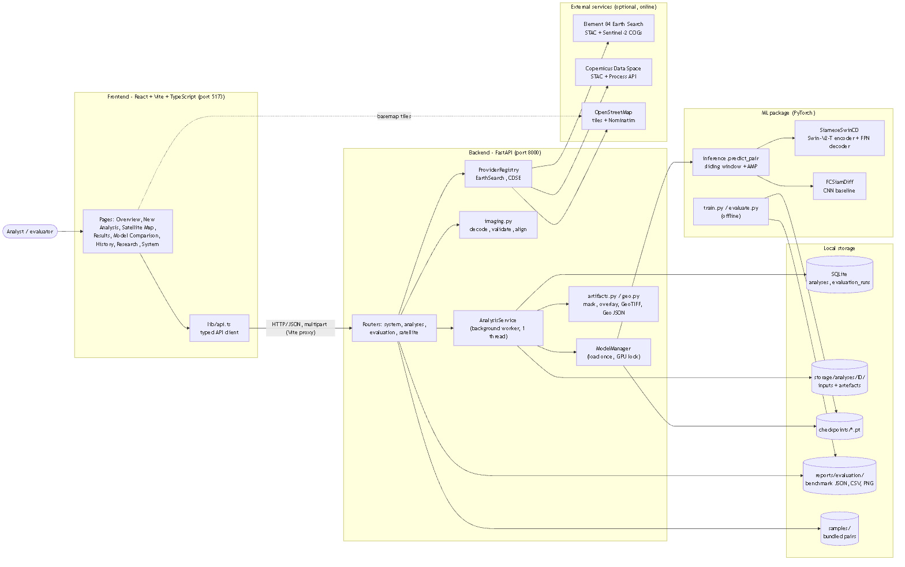
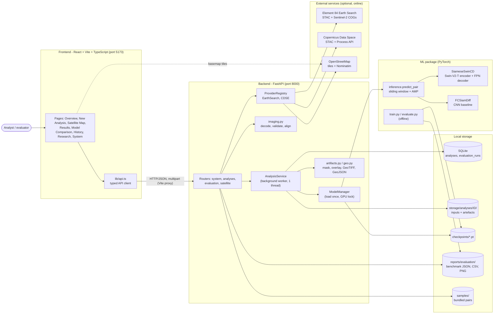
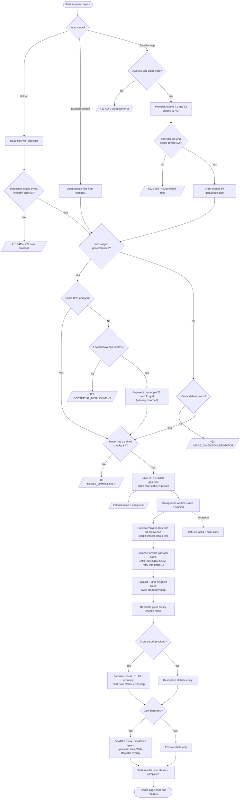
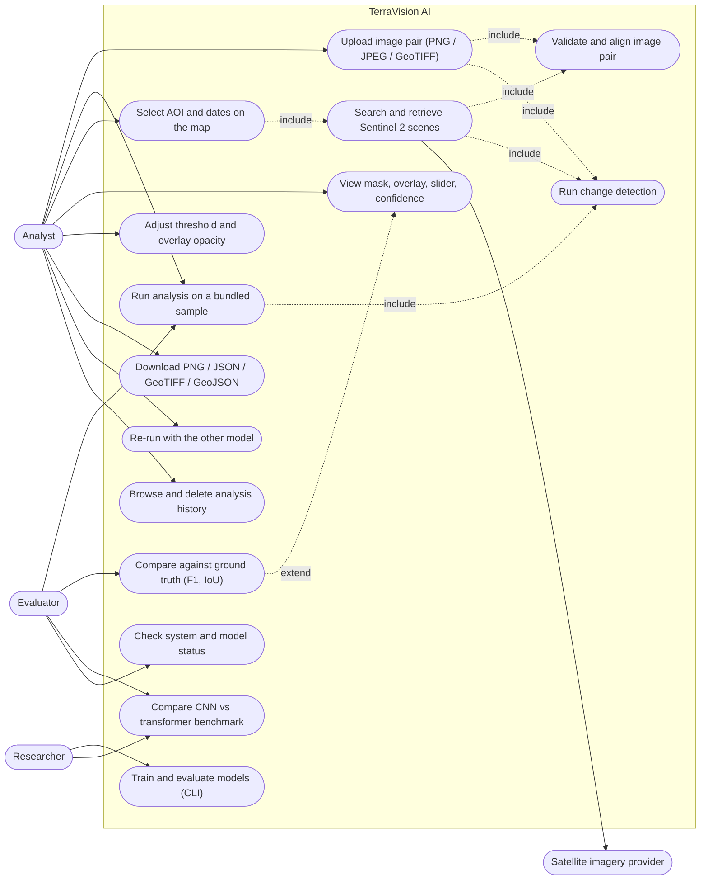
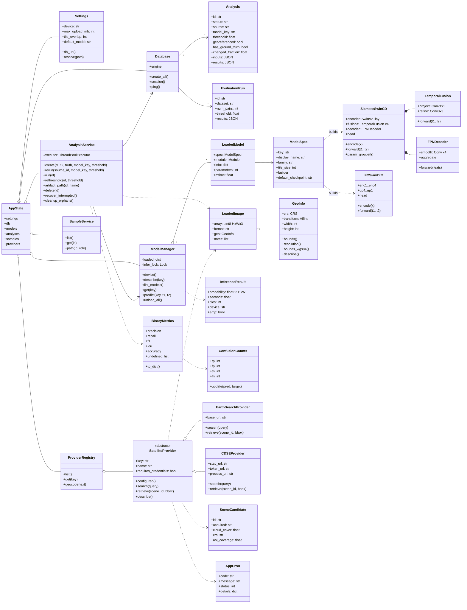
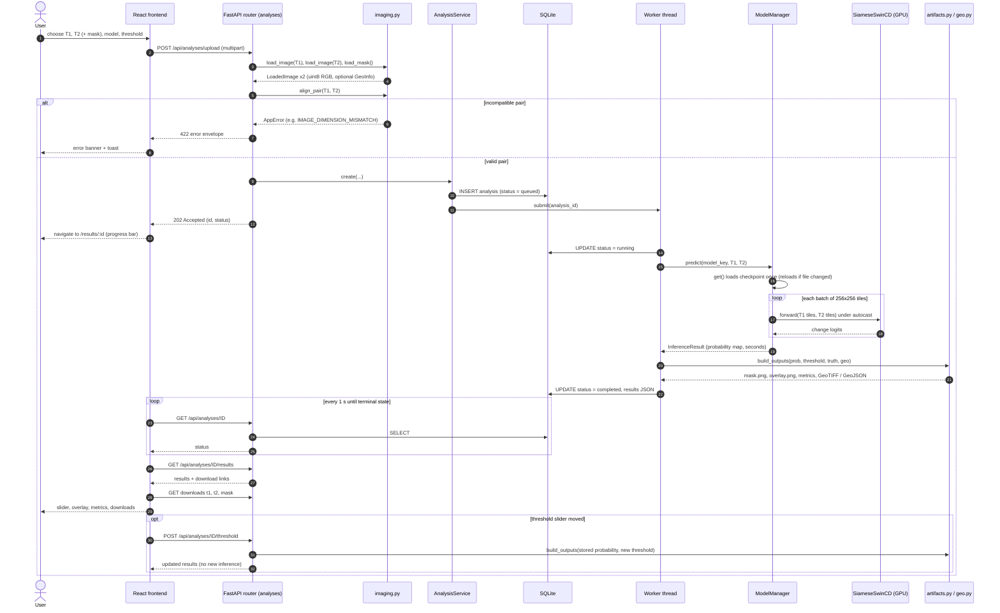
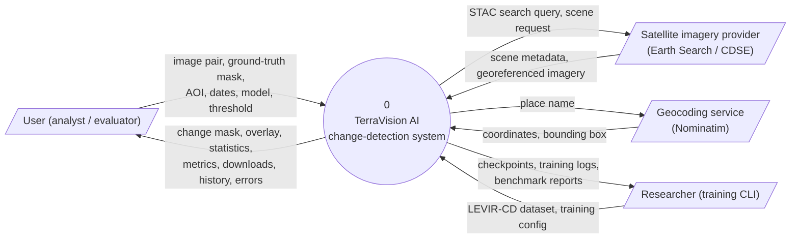
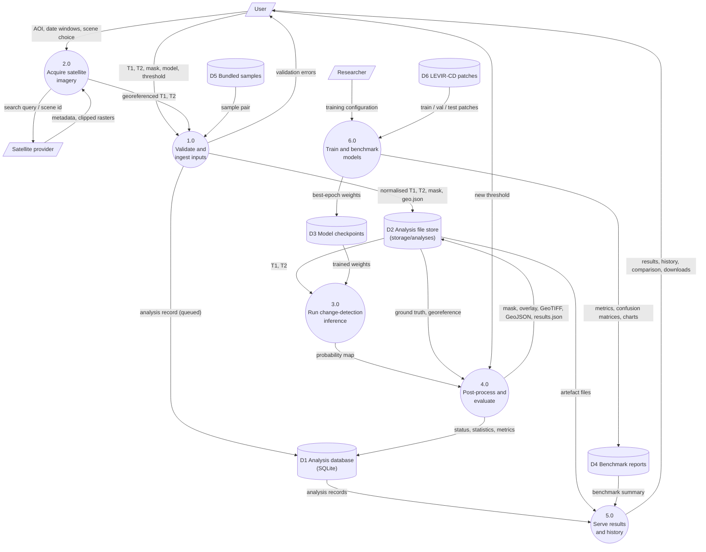

# Architecture and design

TerraVision AI is a three-layer local application: a **React** single-page frontend, a **FastAPI** backend
and an **ML package** (PyTorch), with SQLite and the filesystem as data stores and optional external
imagery services. The layers meet at two narrow interfaces: the HTTP/JSON API, and the checkpoint format plus
`ml.inference.predict_pair`.

## 1. Components

| Component | Responsibility | Code |
|---|---|---|
| Frontend pages | Eight routed pages; typed API client; presentation only | `frontend/src/pages`, `frontend/src/lib/api.ts` |
| Routers | HTTP contracts, validation, response models | `backend/app/routers/` |
| imaging | Decode, validate, stretch, align / reproject image pairs; pair sanity heuristics | `backend/app/services/imaging.py` |
| AnalysisService | Persist inputs, queue and run jobs, re-threshold, artefacts, clean-up, crash recovery | `backend/app/services/analysis.py` |
| ModelManager | Checkpoint status, load-once cache with change detection, GPU lock, CPU fallback, OOM retry, domain-aware model choice | `backend/app/services/model_manager.py` |
| artifacts / geo | Masks, overlays, confidence and error maps; GeoTIFF, GeoJSON, geodesic area, Web-Mercator overlay | `backend/app/services/artifacts.py`, `geo.py` |
| Satellite providers | Provider interface, STAC search, windowed COG reads, CDSE Process API, geocoding | `backend/app/satellite/` |
| Models | SiameseSwinCD, FCSiamDiff behind a registry of four trained variants | `ml/models/` |
| Data | LEVIR-CD and OSCD download, validation, tiling, manifests | `ml/data/` |
| Training / evaluation | Config-driven training, threshold calibration, benchmark reports | `ml/train.py`, `ml/calibrate.py`, `ml/evaluate.py` |
| Inference | Sliding-window bitemporal prediction with blending and AMP | `ml/inference.py` |

## 2. Request lifecycle (upload)

1. `POST /api/analyses/upload` reads both files with a size limit, checks extension, magic bytes and decodability.
2. `imaging.align_pair` rejects incompatible pairs (different sizes, different places) or reprojects T2 onto
   T1's grid when both are georeferenced and overlap by at least 90%.
3. The model is chosen (explicit, or matching the imagery domain) with its calibrated threshold; inputs are
   saved and a row is inserted with status `queued`; the API returns `202 Accepted`.
4. A single background worker runs sliding-window inference on the GPU under a lock, stores the 8-bit
   probability map, then the mask, overlay, metrics (only with ground truth) and georeferenced exports (only
   with georeferenced input), and marks the row `completed` (or `failed` with an error code).
5. The frontend polls `GET /api/analyses/{id}` and then loads `/results` and the artefacts.
   Moving the threshold slider re-thresholds the stored probability map - no new inference.

## 3. Data model

| Store | Contents |
|---|---|
| `analyses` (SQLite) | id, name, status, source, model_key, threshold, timestamps, width, height, georeferenced, has_ground_truth, changed_fraction, inference_seconds, error_code, error_message, inputs (JSON), results (JSON) |
| `evaluation_runs` (SQLite) | id, created_at, dataset, num_pairs, threshold, results (JSON) |
| `storage/analyses/<id>/` | t1/t2 PNG, ground_truth, geo.json, probability, confidence, mask, overlay, error_map, mask.tif, regions.geojson, map overlays, results.json |
| `checkpoints/*.pt` | format_version, model_key, model_kwargs, state_dict, trained, meta |
| `reports/evaluation/` | <model>_metrics.json, metrics.csv, summary.json, cross_domain.json, figures |

## 4. HTTP API

| Method and path | Purpose |
|---|---|
| GET /health | Liveness, database and model availability |
| GET /api/system | Compute device, GPU memory, storage, versions |
| GET /api/models | Model registry with checkpoint and benchmark information |
| GET /api/config | Public limits and defaults |
| GET /api/samples, /api/samples/{id}/{role} | Bundled samples and their images |
| POST /api/analyses/upload | Create an analysis from uploaded T1, T2 (+ mask) - multipart |
| POST /api/analyses | Create an analysis from a bundled sample, or re-run stored inputs with another model |
| GET /api/analyses, /api/analyses/stats | History (paginated, filterable) and overview statistics |
| GET /api/analyses/{id} | Status and details of one analysis |
| GET /api/analyses/{id}/results | Full results and download links (409 until completed) |
| POST /api/analyses/{id}/threshold | Re-threshold the stored probability map |
| GET /api/analyses/{id}/downloads/{artifact} | Whitelisted artefacts: images, JSON, GeoTIFF, GeoJSON |
| DELETE /api/analyses/{id} | Delete the record and its files |
| POST /api/evaluation | Evaluate available models on labelled bundled samples |
| GET /api/evaluation/summary, /reports/{name} | Offline test-split benchmark and figures |
| GET /api/satellite/providers, /geocode | Imagery providers; place search |
| POST /api/satellite/search | Candidate Sentinel-2 scenes for an AOI and date window |
| POST /api/satellite/retrieve | Fetch two scenes for the AOI and start an analysis |

All errors use one envelope: `{"error": {"code", "message", "details"}}`. Interactive schema at
`http://127.0.0.1:8000/docs` when the backend is running.

## 5. Diagrams

All diagrams are Mermaid sources in [`docs/design/diagrams`](design/diagrams) (GitHub renders them below)
with PNG and SVG renders alongside. Each element corresponds to real code (see the component table).

### 5.1 System architecture

Rendered: [PNG](design/diagrams/01_system_architecture.png) - [SVG](design/diagrams/01_system_architecture.svg) - source [`01_system_architecture.mmd`](design/diagrams/01_system_architecture.mmd)

### 5.2 Application flowchart (analysis request)

Rendered: [PNG](design/diagrams/02_flowchart.png) - [SVG](design/diagrams/02_flowchart.svg) - source [`02_flowchart.mmd`](design/diagrams/02_flowchart.mmd)

### 5.3 UML use-case diagram

Rendered: [PNG](design/diagrams/03_use_case.png) - [SVG](design/diagrams/03_use_case.svg) - source [`03_use_case.mmd`](design/diagrams/03_use_case.mmd)

### 5.4 UML class diagram

Rendered: [PNG](design/diagrams/04_class_diagram.png) - [SVG](design/diagrams/04_class_diagram.svg) - source [`04_class_diagram.mmd`](design/diagrams/04_class_diagram.mmd)

### 5.5 UML sequence diagram (upload analysis)

Rendered: [PNG](design/diagrams/05_sequence.png) - [SVG](design/diagrams/05_sequence.svg) - source [`05_sequence.mmd`](design/diagrams/05_sequence.mmd)

### 5.6 DFD level 0 (context diagram)

Rendered: [PNG](design/diagrams/06_dfd_level0.png) - [SVG](design/diagrams/06_dfd_level0.svg) - source [`06_dfd_level0.mmd`](design/diagrams/06_dfd_level0.mmd)

### 5.7 DFD level 1

Rendered: [PNG](design/diagrams/07_dfd_level1.png) - [SVG](design/diagrams/07_dfd_level1.svg) - source [`07_dfd_level1.mmd`](design/diagrams/07_dfd_level1.mmd)

## 6. Technology choices

| Technology | Why |
|---|---|
| PyTorch + timm | Reference Swin-V2 with ImageNet weights; mixed precision; CUDA 12.8 wheels for the RTX 50 series |
| FastAPI + Pydantic | Typed request / response contracts, automatic OpenAPI docs at /docs |
| SQLAlchemy + SQLite | Zero-administration persistence with a path to PostgreSQL |
| Rasterio / pyproj / shapely | CRS-aware raster I/O, reprojection, vectorisation, geodesic area |
| React 19 + Vite + TypeScript (strict) | Component UI with compile-time checking of API types |
| Tailwind, Recharts, Leaflet | Dark theme, charts from live data, interactive map |
| pytest, Vitest, Playwright | Unit / API, component and real-browser end-to-end tests |

## 7. Design decisions and rejected alternatives

| Decision | Rationale | Alternatives rejected |
|---|---|---|
| Encoder: Swin-V2-Tiny at 256x256 with window 8 | A hierarchical encoder gives the four-scale pyramid a dense-prediction decoder needs, and windowed attention is linear in image size. The V2 'window8_256' weights are pre-trained at exactly the 256x256 tile size used here. | Plain ViT-B/16 (single scale, quadratic attention, weaker boundaries); Swin-V1-T at 224 with window 7 (its window does not divide a 256 px tile's 64x64 token grid, forcing position-bias interpolation); larger Swin variants (do not train comfortably in 8 GB). |
| Decoder: per-scale [F1, F2, \|F1-F2\|] fusion + convolutional FPN | Keeps the transformer where it matters (representation) and uses a small convolutional decoder so the whole model is about 30 M parameters and trains at under 2 GB of VRAM. | A Swin transformer decoder as in SwinSUNet (heavier, slower); pure feature differencing without concatenation (discards which date a feature came from). |
| Loss: BCE + batch-level soft Dice | About 55% of LEVIR-CD tiles contain no change. Dice computed over the whole batch stays informative; the first implementation used per-tile Dice and the CNN collapsed to 'no change' (BUG-002). | Per-tile Dice (rejected after BUG-002); BCE alone (biased towards the 95% negative class); focal loss (extra hyper-parameters, not needed once Dice was fixed). |
| Data: pre-tiled uint8 NumPy memmaps | Decoding the three 1024x1024 PNGs of a pair costs about 172 ms per sample against about 4 ms for a memmapped tile (measured, reports/dataloader_benchmark.json); a single-process loader then suffices, which avoids Windows multiprocessing overhead. | On-the-fly PNG decoding with worker processes; random crops from full images (slower, and tiling must stay inside each official split to avoid leakage anyway). |
| Persistence: SQLite + per-analysis folders | A single-user local prototype needs zero-administration storage; SQLAlchemy keeps the door open for PostgreSQL. Artefacts are files because they are large binary rasters. | PostgreSQL / PostGIS (operational overhead with no Phase-1 benefit); storing images as database BLOBs. |
| Jobs: one in-process worker thread | There is one GPU, so inference must be serialised anyway; a ThreadPoolExecutor(max_workers=1) gives background execution with no extra services and works natively on Windows. | Celery / Redis (extra infrastructure); running inference inside the request (blocks the API and times out on large rasters). |
| Store the probability map, re-threshold on demand | The 8-bit probability map is saved once; changing the threshold recomputes mask, metrics and exports in milliseconds without touching the GPU. | Re-running inference per threshold; thresholding only in the browser (downloads and metrics would then disagree with what is shown). |
| Sentinel-2 models: fine-tune the LEVIR-CD networks on OSCD RGB with TCI-matched radiometry | OSCD has only 11 training cities, so both networks start from their LEVIR-CD weights (building-change features) instead of ImageNet. OSCD's 16-bit bands are scaled with the gain measured on real Earth Search true-colour pixels (DN 2500 -> 255; reports/tci_gain_fit.json) so training data looks like what the app receives. Padded border pixels are excluded from loss and metrics (ignore index 255). | Training on all 13 bands (the app's imagery source delivers RGB only); per-image percentile stretching (would not match the fixed TCI scaling at inference); training from ImageNet only (too little data). |
| Decision threshold chosen on the validation split | Change is 2-3% of OSCD pixels, so 0.5 is not necessarily the best operating point. ml.calibrate sweeps 0.05-0.95 on the validation cities and stores the best threshold in the checkpoint; the app uses it as the default and the user can still override it. | Fixed 0.5 for every model; tuning on the test split (would leak test information). |
| Imagery: Earth Search COGs as the default provider, CDSE optional | Element 84 Earth Search serves Sentinel-2 L2A as public cloud-optimised GeoTIFFs: no account is needed and only the AOI window is read. CDSE is implemented behind the same interface but needs the user's own OAuth client. | Web-map tiles (rendered pictures without dates or radiometry - explicitly rejected); downloading whole Sentinel-2 products (about 1 GB each). |

## 8. Deviations from the original brief

| Deviation | Reason |
|---|---|
| CDSE is not the default imagery provider | The brief preferred the Copernicus Data Space Ecosystem. Retrieval there needs OAuth credentials that were not available, so Earth Search (same Sentinel-2 L2A data, no account) is the verified default and CDSE remains implemented but unverified. |
| CNN baseline uses dropout 0.1 and stopped early | The FC-Siam-diff paper uses dropout 0.2; 0.1 was used because the overfit diagnostic showed 0.2 slows convergence within a 40-epoch budget. Early stopping (patience 10) ended training at epoch 25, so the baseline is weaker than figures reported in the literature for longer schedules. |
| Swin batch size was reduced automatically | The configuration requested batch 8; the conservative VRAM heuristic in train.py reduced it to 5 with gradient accumulation 2 (effective batch 10) because a second training run was sharing the GPU. |
| Sentinel-2 / OSCD work moved from Phase 2 into Phase 1 | The LEVIR-CD models produced 0.00% change on real Sentinel-2 imagery (BUG-006), so OSCD training, a cross-domain evaluation and Sentinel-2 model variants were added in Phase 1. Only the RGB bands are used. |
| Linting uses oxlint instead of ESLint | The current Vite React-TS template ships oxlint with TypeScript 7; it was kept rather than adding an ESLint toolchain whose TypeScript-7 support was not verified. |
| Docker files are provided but untested | Docker is not installed on the development machine; native Windows execution is the supported and verified path. |
| Database migrations are a schema-version table only | With two tables and no released schema to migrate from, Alembic was deferred; create_all plus a schema_version row is used. |

## 9. Requirement traceability

| ID | Requirement | Type | Priority | Design element | Code | Verification |
|---|---|---|---|---|---|---|
| R1 | Accept a bitemporal image pair (PNG, JPEG, GeoTIFF) and an optional ground-truth mask; validate type, integrity, size, channels and pair compatibility before any processing. | Functional | High | imaging.load_image / align_pair; POST /api/analyses/upload; FileDrop component | backend/app/services/imaging.py, backend/app/routers/analyses.py | tests/test_imaging.py, tests/test_api.py |
| R2 | Predict a pixel-level binary change mask with a Siamese Swin Transformer whose encoder and decoder are trained on a change-detection dataset. | Functional | High | SiameseSwinCD (shared Swin-V2-T encoder, TemporalFusion x4, FPNDecoder); predict_pair | ml/models/swin_siamese.py, ml/inference.py | tests/test_models.py; reports/evaluation/swin_siamese_metrics.json |
| R3 | Provide a CNN baseline (FC-Siam-diff) selectable at run time through a model registry. | Functional | High | FCSiamDiff; MODEL_SPECS registry; ModelManager; ModelSelect component | ml/models/fc_siam_diff.py, ml/models/registry.py, backend/app/services/model_manager.py | tests/test_models.py, tests/test_api.py |
| R4 | Compute TP, FP, TN, FN, precision, recall, F1, IoU, pixel accuracy and a confusion matrix, only when ground truth is available; guard zero denominators. | Functional | High | ConfusionCounts / compute_metrics; artifacts.build_outputs; MetricsCard | ml/metrics.py, backend/app/services/artifacts.py | tests/test_metrics.py (cross-checked with scikit-learn) |
| R5 | Visualise before / after images, a comparison slider, the change mask, a coloured overlay and a confidence map; allow threshold and overlay-opacity adjustment. | Functional | High | Results page (CompareSlider, maskOverlay); POST /api/analyses/{id}/threshold (re-threshold stored probability map) | frontend/src/pages/Results.tsx, backend/app/services/analysis.py | frontend/src/test/app.test.tsx, frontend/e2e/demo.spec.ts, tests/test_api.py |
| R6 | Download the mask, overlay and results (PNG / JSON), plus a GeoTIFF mask and GeoJSON regions when the input is georeferenced. | Functional | Medium | ARTIFACTS whitelist; GET /api/analyses/{id}/downloads/{artifact}; geo.write_geotiff / change_regions | backend/app/services/artifacts.py, backend/app/services/geo.py | tests/test_api.py, tests/test_geo.py |
| R7 | Persist every analysis with status, model, threshold and results; show history and live overview statistics. | Functional | Medium | SQLite via SQLAlchemy (Analysis, EvaluationRun); /api/analyses, /api/analyses/stats; Overview and History pages | backend/app/db.py, frontend/src/pages/History.tsx | tests/test_api.py (persistence, restart recovery) |
| R8 | Compare the transformer and the CNN on the same held-out split and present the measured results in a dashboard. | Functional | High | ml.evaluate (test split, fixed threshold); GET /api/evaluation/summary; Compare page (Recharts) | ml/evaluate.py, backend/app/routers/evaluation.py, frontend/src/pages/Compare.tsx | tests/test_data_training.py, tests/test_api.py; reports/evaluation/ |
| R9 | Handle GeoTIFF input: validate CRS, extract bounds and resolution, reproject / resample T2 onto the T1 grid, export a georeferenced mask and display results on a map. | Functional | Medium | GeoInfo; align_pair (rasterio.warp.reproject); web_mercator_overlay; GeoMap component | backend/app/services/imaging.py, backend/app/services/geo.py, frontend/src/components/maps.tsx | tests/test_imaging.py, tests/test_geo.py, frontend/e2e/demo.spec.ts |
| R10 | Map-based acquisition: search a place, draw an area of interest, choose two date windows, list candidate scenes with cloud cover, retrieve georeferenced imagery and run detection. | Functional | Medium | SatelliteProvider abstraction (EarthSearchProvider, CDSEProvider); /api/satellite/*; Map page | backend/app/satellite/, frontend/src/pages/MapPage.tsx | tests/test_satellite.py, frontend/e2e/demo.spec.ts |
| R11 | Reproducible experiments: verified dataset download, leakage-free tiling with a split manifest, configurable training with seeds, machine-readable logs; the test split is never used for training or model selection. | Functional | High | ml.data.download (MD5), ml.data.prepare (manifest, leakage check), ml.train (config.json, history.jsonl) | ml/data/, ml/train.py, ml/configs/ | tests/test_data_training.py; experiments/*/ |
| R12 | Every failure returns a consistent, machine-readable error; background failures are recorded on the analysis; the UI shows loading, empty and error states. | Non-functional | High | AppError + error envelope handlers; AnalysisService._run_safely; ErrorBanner / EmptyState / toasts | backend/app/errors.py, frontend/src/components/ui.tsx | tests/test_api.py, frontend/src/test/app.test.tsx |
| R13 | Run on an 8 GB consumer GPU with mixed precision and fall back to CPU automatically; load each model once and serialise GPU access. | Non-functional | Medium | ModelManager (load once, inference lock, OOM retry, CPU fallback); autocast; sliding window | backend/app/services/model_manager.py, ml/inference.py | tests/test_models.py, tests/test_api.py; benchmark latency |
| R14 | Safe file handling for a local prototype: upload size limits, magic-byte checks, server-generated identifiers, whitelisted artefact names, no filesystem paths in responses, restricted CORS. | Non-functional | High | detect_format; _read_limited; AnalysisService.folder id check; CORS middleware | backend/app/services/imaging.py, backend/app/routers/analyses.py, backend/app/main.py | tests/test_api.py |
| R15 | Trustworthy output: never serve an untrained or mismatched checkpoint, show the checkpoint version with every result, never fabricate coordinates, areas or metrics. | Non-functional | High | ml.checkpoint validation ('trained' flag, strict load); checkpoint version + SHA-256; geo only when present | ml/checkpoint.py, backend/app/services/artifacts.py | tests/test_models.py, tests/test_api.py |
| R16 | Responsive, accessible dark dashboard with eight pages; every control performs a real action. | Non-functional | Medium | Layout (responsive sidebar), Tailwind theme, ARIA roles/labels on controls | frontend/src/components/Layout.tsx, frontend/src/pages/ | frontend/src/test/app.test.tsx, frontend/e2e/demo.spec.ts |
| R17 | Automated test suite covering unit, API, integration, boundary and negative cases, with recorded execution logs. | Non-functional | High | pytest + HTTPX TestClient, Vitest + Testing Library, Playwright | tests/, frontend/src/test/, frontend/e2e/ | evidence/tests/ |
| R18 | Detect change on real Sentinel-2 (10 m) imagery: provide models trained on Sentinel-2 data, choose the model that matches the imagery automatically, and flag any model / imagery domain mismatch. | Functional | High | swin_siamese_s2 / fc_siam_diff_s2 (OSCD fine-tune); preferred_model + domain_warning; ml.data.oscd; ml.calibrate | ml/data/oscd.py, ml/models/registry.py, backend/app/services/model_manager.py | tests/test_api.py (domain selection), tests/test_data_training.py (OSCD), e2e 08-09; reports/evaluation/*_s2_metrics.json |

## 10. Security measures (local research prototype)

Present: extension + magic-byte + decode validation, size limits, server-generated ids, whitelisted artefact
names, no filesystem paths in responses, CORS restricted to the frontend origin, asset-host allow-list for
satellite reads, safe weights-only checkpoint loading. Not present: authentication, rate limiting, HTTPS -
this is not a production deployment.
