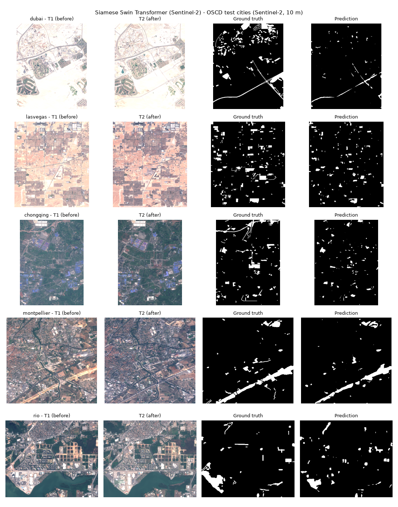

# Models

Four trained models are served through one registry (`ml/models/registry.py`): two network architectures,
each trained for two imagery domains.

| Key | Model | Family | Imagery domain | Parameters | Checkpoint |
|---|---|---|---|---|---|
| `swin_siamese` | Siamese Swin Transformer | transformer | 0.5 m aerial (LEVIR-CD) | 29,976,299 | `checkpoints/swin_siamese_levir.pt` |
| `fc_siam_diff` | FC-Siam-diff (CNN baseline) | CNN | 0.5 m aerial (LEVIR-CD) | 968,209 | `checkpoints/fc_siam_diff_levir.pt` |
| `swin_siamese_s2` | Siamese Swin Transformer (Sentinel-2) | transformer | 10 m Sentinel-2 (OSCD) | 29,976,299 | `checkpoints/swin_siamese_oscd.pt` |
| `fc_siam_diff_s2` | FC-Siam-diff CNN (Sentinel-2) | CNN | 10 m Sentinel-2 (OSCD) | 968,209 | `checkpoints/fc_siam_diff_oscd.pt` |

The application picks the model that matches the input imagery (bundled sample domain, or pixel size of a
GeoTIFF: >= 5 m is Sentinel-2) and warns when a user forces a mismatched model.

## 1. Primary model - Siamese Swin Transformer (`ml/models/swin_siamese.py`)

```
T1 ─┐                        ┌─ F1 (4 scales) ─┐
    ├─ shared Swin-V2-Tiny ──┤                 ├─ TemporalFusion x4 ─ FPN decoder ─ head ─ logits ─ sigmoid ─ mask
T2 ─┘   (one set of weights) └─ F2 (4 scales) ─┘   concat(F1, F2, |F1-F2|) -> 1x1 conv -> 3x3 conv
```

- **Encoder:** timm `swinv2_tiny_window8_256`, ImageNet-1k pre-trained; strides 4/8/16/32 with
  96/192/384/768 channels. Both dates pass through it in one batch, so weights are shared by construction.
- **Fusion:** at every scale, `concat(F1, F2, |F1-F2|)` -> 1x1 conv -> 3x3 conv (128 channels). The difference
  makes change explicit; F1 and F2 keep "what was there before / after".
- **Decoder:** top-down FPN with lateral additions, all levels upsampled to stride 4 and aggregated; a
  two-layer head outputs one logit channel, bilinearly upsampled to 256x256.
- **Inference on any image size:** 256 px tiles with 64 px overlap, Hann-window blending, mixed precision
  (`ml/inference.py`).

## 2. Baseline - FC-Siam-diff (`ml/models/fc_siam_diff.py`)

Re-implementation of Daudt, Le Saux & Boulch, "Fully Convolutional Siamese Networks for Change Detection",
ICIP 2018 (doi:10.1109/ICIP.2018.8451652): a shared 4-level U-Net encoder (16-32-64-128 channels) whose skip
connections carry the absolute difference of the two dates' features.

## 3. Why these models

- **Why a transformer:** the project objective is to evaluate transformer-based change detection against CNNs.
  Windowed self-attention gives long-range context (separating real structural change from illumination and
  seasonal pseudo-change) at linear cost in image size.
- **Why Swin-V2-Tiny specifically:** hierarchical (gives the multi-scale pyramid a segmentation decoder needs),
  pre-trained at exactly the 256x256 tile size used here, and small enough to train in 8 GB of VRAM.
- **Why FC-Siam-diff as the baseline:** the canonical Siamese CNN for change detection, cited by every later
  paper surveyed; small, fast, and trained from scratch, so it isolates the effect of the architecture.
- **Why separate Sentinel-2 models:** at 10 m a building is 1-2 pixels; models trained on 0.5 m imagery find
  nothing (measured below). Fine-tuning from the LEVIR-CD weights reuses learned building-change features
  despite OSCD's small size (11 training cities).

| Decision | Rationale | Alternatives rejected |
|---|---|---|
| Encoder: Swin-V2-Tiny at 256x256 with window 8 | A hierarchical encoder gives the four-scale pyramid a dense-prediction decoder needs, and windowed attention is linear in image size. The V2 'window8_256' weights are pre-trained at exactly the 256x256 tile size used here. | Plain ViT-B/16 (single scale, quadratic attention, weaker boundaries); Swin-V1-T at 224 with window 7 (its window does not divide a 256 px tile's 64x64 token grid, forcing position-bias interpolation); larger Swin variants (do not train comfortably in 8 GB). |
| Decoder: per-scale [F1, F2, \|F1-F2\|] fusion + convolutional FPN | Keeps the transformer where it matters (representation) and uses a small convolutional decoder so the whole model is about 30 M parameters and trains at under 2 GB of VRAM. | A Swin transformer decoder as in SwinSUNet (heavier, slower); pure feature differencing without concatenation (discards which date a feature came from). |
| Loss: BCE + batch-level soft Dice | About 55% of LEVIR-CD tiles contain no change. Dice computed over the whole batch stays informative; the first implementation used per-tile Dice and the CNN collapsed to 'no change' (BUG-002). | Per-tile Dice (rejected after BUG-002); BCE alone (biased towards the 95% negative class); focal loss (extra hyper-parameters, not needed once Dice was fixed). |
| Sentinel-2 models: fine-tune the LEVIR-CD networks on OSCD RGB with TCI-matched radiometry | OSCD has only 11 training cities, so both networks start from their LEVIR-CD weights (building-change features) instead of ImageNet. OSCD's 16-bit bands are scaled with the gain measured on real Earth Search true-colour pixels (DN 2500 -> 255; reports/tci_gain_fit.json) so training data looks like what the app receives. Padded border pixels are excluded from loss and metrics (ignore index 255). | Training on all 13 bands (the app's imagery source delivers RGB only); per-image percentile stretching (would not match the fixed TCI scaling at inference); training from ImageNet only (too little data). |
| Decision threshold chosen on the validation split | Change is 2-3% of OSCD pixels, so 0.5 is not necessarily the best operating point. ml.calibrate sweeps 0.05-0.95 on the validation cities and stores the best threshold in the checkpoint; the app uses it as the default and the user can still override it. | Fixed 0.5 for every model; tuning on the test split (would leak test information). |

## 4. Training configuration (from `experiments/*/config.json`)

| Model | Dataset | Initialised from | Batch | Grad. accum. | LR | Max epochs | Patience | Weight decay | Seed |
|---|---|---|---|---|---|---|---|---|---|
| Siamese Swin Transformer | LEVIR-CD | ImageNet (Swin encoder) / random (CNN) | 5 | 2 | 0.0002 | 30 | 8 | 0.01 | 42 |
| FC-Siam-diff (CNN baseline) | LEVIR-CD | ImageNet (Swin encoder) / random (CNN) | 16 | 1 | 0.001 | 40 | 10 | 0.0001 | 42 |
| Siamese Swin Transformer (Sentinel-2) | OSCD | swin_siamese_levir.pt | 8 | 1 | 0.0001 | 80 | 20 | 0.01 | 42 |
| FC-Siam-diff CNN (Sentinel-2) | OSCD | fc_siam_diff_levir.pt | 16 | 1 | 0.0005 | 120 | 25 | 0.0001 | 42 |

Common to all runs (`ml/train.py`): AdamW, BCE + batch-level soft Dice loss (BUG-002 explains why batch-level),
linear warm-up then cosine decay, gradient clipping at 1.0, mixed precision, flips / 90-degree rotations /
temporal swap / per-date photometric jitter, early stopping on validation F1, best-epoch checkpoint.

| Model | Run | Batch | Grad. accum. | LR | Epochs | Best val F1 | Train time | Peak VRAM (train) |
|---|---|---|---|---|---|---|---|---|
| Siamese Swin Transformer | swin_siamese_levir_v2 (LEVIR-CD) | 5 | 2 | 0.0002 | 30 (best 29) | 91.82% | 127 min | 1915 MB |
| FC-Siam-diff (CNN baseline) | fc_siam_diff_levir_v2 (LEVIR-CD) | 16 | 1 | 0.001 | 25 (best 15) | 79.25% | 74 min | 1499 MB |
| Siamese Swin Transformer (Sentinel-2) | swin_siamese_oscd_v1 (OSCD) | 8 | 1 | 0.0001 | 43 (best 23) | 45.35% | 5 min | 2608 MB |
| FC-Siam-diff CNN (Sentinel-2) | fc_siam_diff_oscd_v1 (OSCD) | 16 | 1 | 0.0005 | 39 (best 14) | 32.98% | 2 min | 1507 MB |

## 5. Decision thresholds

For the Sentinel-2 models the threshold is chosen on the **validation** cities (`ml/calibrate.py`, grid
0.05-0.95) and stored in the checkpoint; the application uses it as the default. The LEVIR-CD models use 0.5.

| Model | Selected threshold | Val F1 at 0.5 | Val F1 at selected |
|---|---|---|---|
| Siamese Swin Transformer (Sentinel-2) | 0.2 | 45.35% | 45.70% |
| FC-Siam-diff CNN (Sentinel-2) | 0.05 | 32.98% | 44.97% |

The CNN's selected threshold lies at the edge of the grid, which indicates under-confident probabilities.

## 6. Results (held-out test data)

| Test data | Model | Precision | Recall | F1 | IoU | Accuracy | Threshold | Params | Latency / tile |
|---|---|---|---|---|---|---|---|---|---|
| LEVIR-CD | Siamese Swin Transformer | 92.45% | 90.27% | 91.35% | 84.07% | 99.13% | 0.5 | 29.98 M | 21.9 ms |
| LEVIR-CD | FC-Siam-diff (CNN baseline) | 90.53% | 68.35% | 77.89% | 63.79% | 98.02% | 0.5 | 0.97 M | 5.7 ms |
| OSCD | Siamese Swin Transformer (Sentinel-2) | 66.85% | 36.35% | 47.09% | 30.80% | 95.78% | 0.2 | 29.98 M | 21.9 ms |
| OSCD | FC-Siam-diff CNN (Sentinel-2) | 55.89% | 30.79% | 39.70% | 24.77% | 95.17% | 0.05 | 0.97 M | 5.3 ms |

**Domain shift** - the OSCD Sentinel-2 test cities scored by models with and without Sentinel-2 training:

| Model (scored on OSCD test cities) | Trained on | Precision | Recall | F1 | IoU |
|---|---|---|---|---|---|
| Siamese Swin Transformer | LEVIR-CD only | n/a | 0.00% | 0.00% | 0.00% |
| FC-Siam-diff (CNN baseline) | LEVIR-CD only | 100.00% | 0.30% | 0.59% | 0.30% |
| Siamese Swin Transformer (Sentinel-2) | LEVIR-CD, then OSCD fine-tune | 66.85% | 36.35% | 47.09% | 30.80% |
| FC-Siam-diff CNN (Sentinel-2) | LEVIR-CD, then OSCD fine-tune | 55.89% | 30.79% | 39.70% | 24.77% |

On the held-out LEVIR-CD test split (2048 patches of 256x256 px at 0.5 m, threshold 0.5), the Siamese Swin Transformer reaches F1 91.35% and IoU 84.07%; the FC-Siam-diff baseline reaches F1 77.89% and IoU 63.79%. On real Sentinel-2 imagery (the 10 OSCD test cities at 10 m, whole images, thresholds selected on validation cities) the fine-tuned Swin model reaches F1 47.09% and IoU 30.80% against F1 39.70% and IoU 24.77% for the CNN, whereas the LEVIR-CD-only Swin model scores F1 0.00% on the same cities. The transformer costs 31x the parameters and 3.8x the per-tile latency (22 ms vs 6 ms on NVIDIA GeForce RTX 5050 Laptop GPU). All results come from a single training run per model (seed 42).

Charts: [LEVIR-CD](../reports/evaluation/model_comparison.png) - [OSCD](../reports/evaluation/model_comparison_oscd.png).
Prediction examples: [Swin LEVIR-CD](../reports/evaluation/swin_siamese_examples.png) -
[Swin Sentinel-2](../reports/evaluation/swin_siamese_s2_examples.png) -
[CNN LEVIR-CD](../reports/evaluation/fc_siam_diff_examples.png) -
[CNN Sentinel-2](../reports/evaluation/fc_siam_diff_s2_examples.png).
Raw numbers: [`reports/evaluation/metrics.csv`](../reports/evaluation/metrics.csv),
[`summary.json`](../reports/evaluation/summary.json).



## 7. Checkpoints

Format (`ml/checkpoint.py`): a plain dict loaded with `torch.load(weights_only=True)` containing
`format_version, model_key, model_kwargs, state_dict, trained, meta`. The application refuses files that are
missing, unreadable, not marked as trained, or do not match the architecture; every result shows the
checkpoint version and SHA-256. Checkpoints are not stored in git (the Swin file exceeds GitHub's 100 MB limit):
download them from the repository's **Releases** page into `checkpoints/`, or re-train with the commands in
[Implementation_Guide.md](Implementation_Guide.md).

## 8. Limitations

- Two imagery domains are validated: 0.5 m LEVIR-CD-like aerial RGB and 10 m Sentinel-2 RGB (OSCD). Sentinel-2 accuracy is moderate (see the OSCD benchmark): small or thin changes are missed, and on the Bengaluru pair seasonal farmland and lakes that filled with water are also flagged. Deforestation and disaster damage are not supported.
- OSCD is small (11 training cities) and is Level-1C top-of-atmosphere data while the application receives Level-2A true colour; only the DN scale is matched, not the atmospheric correction. The CNN's selected threshold (0.05) lies at the edge of the search grid.
- Single training run per model (seed 42); no confidence intervals. The CNN baseline stopped early at epoch 25 and is weaker than figures reported in the literature for FC-Siam-diff trained longer.
