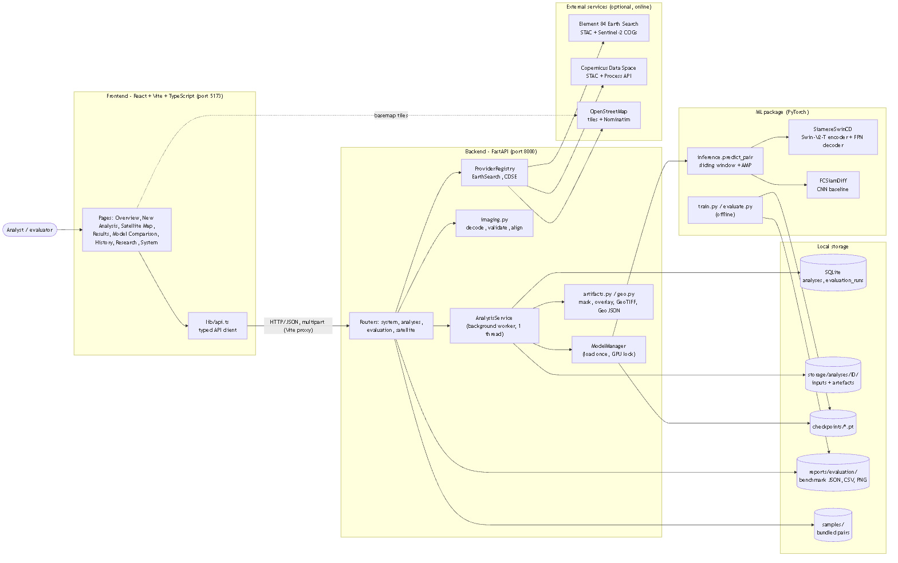
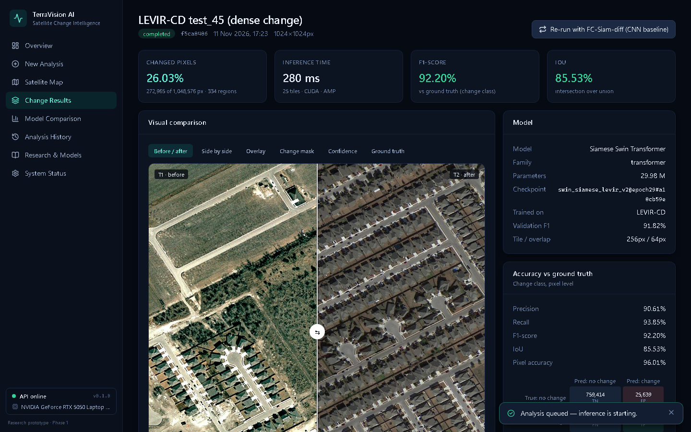
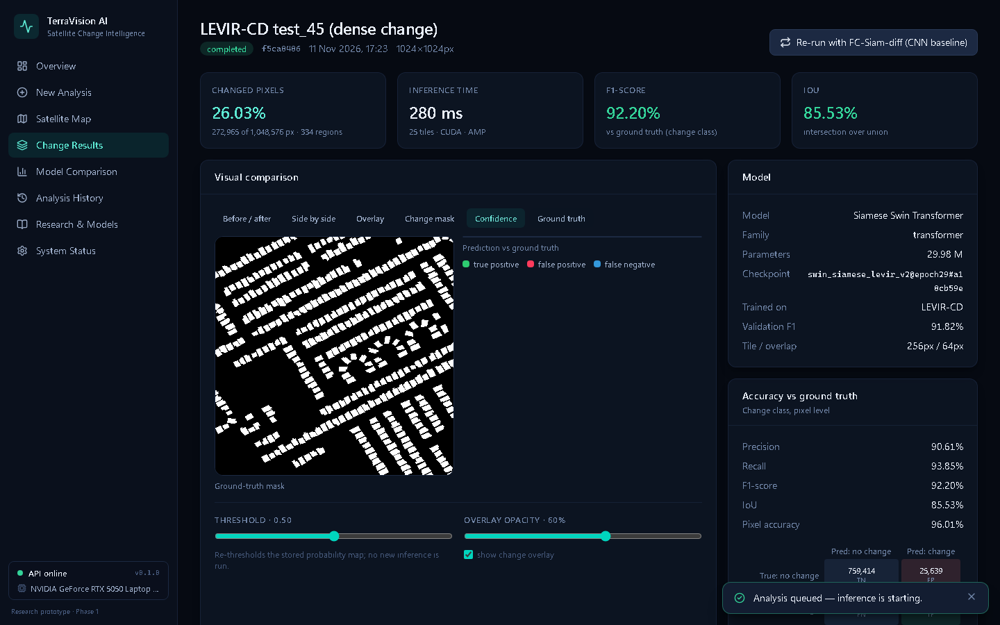
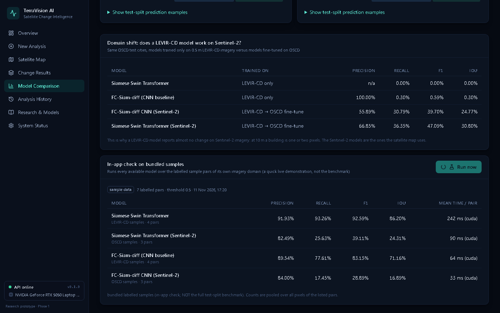
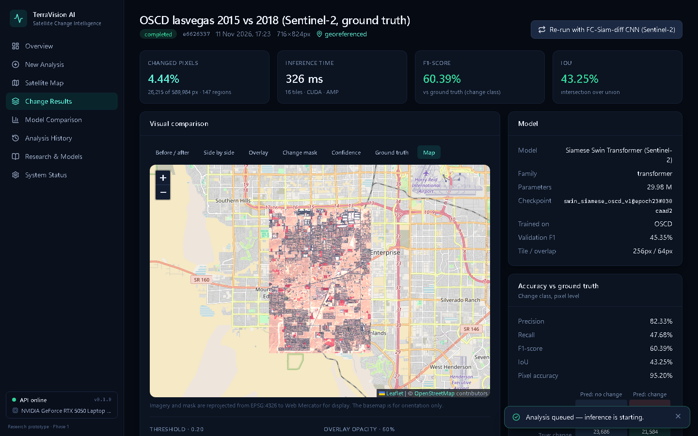
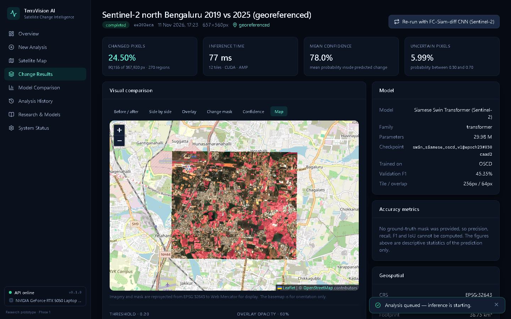
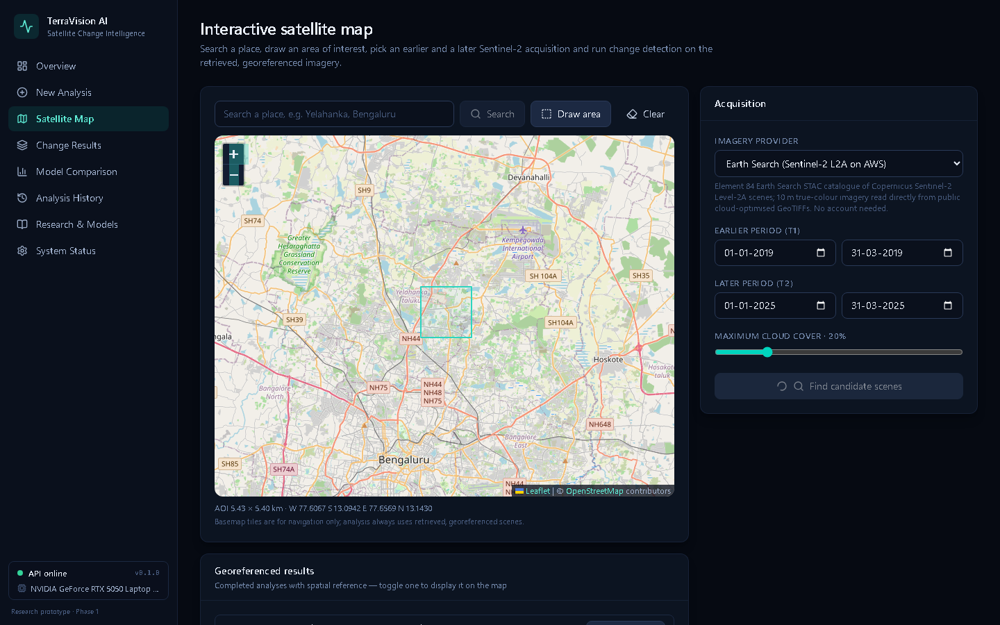
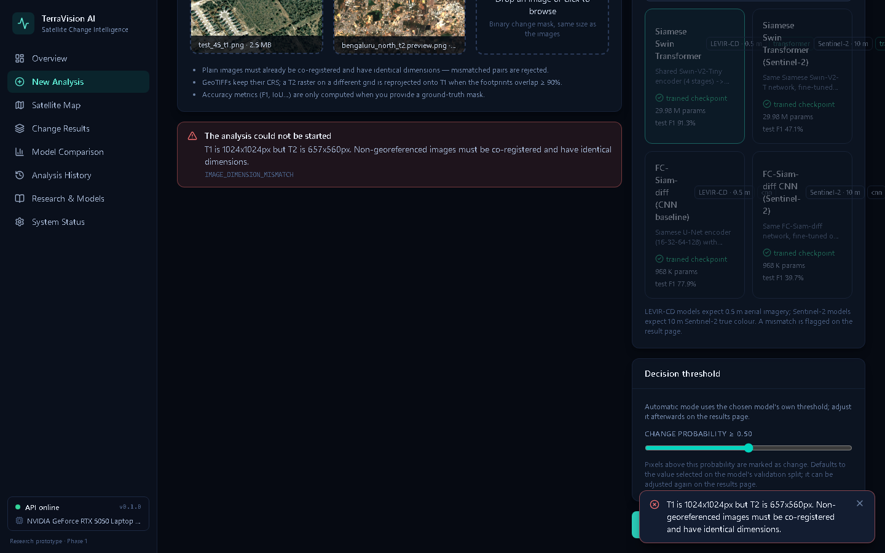

# Phase 1 project report - Vision Transformers for Satellite Land-Use Monitoring

TerraVision AI - Satellite Change Intelligence: a research prototype for bitemporal satellite change detection. This report covers the problem,
literature, requirements, design, implementation, results, testing and the plan for Phase 2.

> All implementation, training runs and tests recorded here were carried out on 11 November 2026
> (see `experiments/*/config.json`, `evidence/tests/` and the git history).

## Abstract

On the held-out LEVIR-CD test split (2048 patches of 256x256 px at 0.5 m, threshold 0.5), the Siamese Swin Transformer reaches F1 91.35% and IoU 84.07%; the FC-Siam-diff baseline reaches F1 77.89% and IoU 63.79%. On real Sentinel-2 imagery (the 10 OSCD test cities at 10 m, whole images, thresholds selected on validation cities) the fine-tuned Swin model reaches F1 47.09% and IoU 30.80% against F1 39.70% and IoU 24.77% for the CNN, whereas the LEVIR-CD-only Swin model scores F1 0.00% on the same cities. The transformer costs 31x the parameters and 3.8x the per-tile latency (22 ms vs 6 ms on NVIDIA GeForce RTX 5050 Laptop GPU). All results come from a single training run per model (seed 42).

## 1. Literature survey and requirement analysis

### 1.1 Problem statement

Urban planners, environmental agencies and disaster-response teams need to know where land use has changed between two satellite acquisitions, but comparing image pairs by eye does not scale and classical pixel differencing is swamped by illumination, seasonal and registration differences. Convolutional change-detection networks improved on this, yet their local receptive fields limit the long-range context needed to separate real structural change from such pseudo-change. This project designs, implements and evaluates a Siamese Swin Transformer that predicts pixel-level building/urban change from bitemporal imagery, benchmarks it against a CNN baseline (FC-Siam-diff) on the same held-out data, and delivers it as a working application (TerraVision AI) so an analyst can upload or fetch an image pair and obtain a verifiable change map.

### 1.2 Literature survey

Nine verified sources; full table in [LITERATURE_SURVEY.md](LITERATURE_SURVEY.md).

| Paper | Approach | Limitation |
|---|---|---|
| R. Caye Daudt, B. Le Saux, A. Boulch (2018), 25th IEEE International Conference on Image Processing (ICIP), pp. 4063-4067 | Three fully convolutional U-Net variants trained end-to-end from scratch: early fusion (FC-EF) and two Siamese designs whose skip connections carry either concatenated (FC-Siam-conc) or absolute-difference (FC-Siam-diff) encoder features. | Purely local receptive field from stacked 3x3 convolutions; limited long-range context, so large structures and pseudo-changes (illumination, season) are harder to separate. |
| R. Caye Daudt, B. Le Saux, A. Boulch, Y. Gousseau (2018), IEEE International Geoscience and Remote Sensing Symposium (IGARSS), pp. 2115-2118 | Introduces the Onera Satellite Change Detection (OSCD) dataset of registered Sentinel-2 multispectral image pairs with urban-change labels, and patch-based early-fusion and Siamese CNN classifiers. | Small dataset (24 city pairs) at 10-60 m resolution with coarse, noisy labels; patch-wise classification rather than dense prediction. |
| H. Chen, Z. Shi (2020), Remote Sensing, 12(10), 1662 | Siamese ResNet feature extractor followed by a spatial-temporal self-attention module (STANet) computed over both dates jointly, trained with a metric (contrastive) loss; releases the LEVIR-CD dataset of 637 very-high-resolution 1024x1024 pairs. | Attention is applied to a single low-resolution CNN feature map and is costly; the dataset covers only building change in Texas, USA, at 0.5 m, limiting geographic and semantic diversity. |
| S. Fang, K. Li, J. Shao, Z. Li (2022), IEEE Geoscience and Remote Sensing Letters, vol. 19, pp. 1-5 | Combines a Siamese encoder with a densely connected NestedUNet (UNet++) decoder and an ensemble channel attention module to aggregate multi-level semantic features. | Still convolution-only, so global context is limited; dense connections increase memory use and inference cost. |
| H. Chen, Z. Qi, Z. Shi (2022), IEEE Transactions on Geoscience and Remote Sensing, vol. 60, pp. 1-14 | Bitemporal Image Transformer (BIT): a ResNet backbone produces features that are compressed into a few semantic tokens per date; a transformer encoder models context over the tokens of both dates and a transformer decoder projects them back to pixel space before feature differencing. | Hybrid design that still depends on a CNN backbone; the transformer operates on a single coarse scale, so there is no hierarchical multi-scale transformer representation. |
| W. G. C. Bandara, V. M. Patel (2022), IEEE International Geoscience and Remote Sensing Symposium (IGARSS), pp. 207-210 | ChangeFormer: a Siamese hierarchical transformer encoder produces multi-scale features for each date; per-scale difference modules feed a lightweight MLP decoder that predicts the change map. | Trained from scratch-style setups need long schedules and large memory; evaluated on building-centric VHR datasets only. |
| C. Zhang, L. Wang, S. Cheng, Y. Li (2022), IEEE Transactions on Geoscience and Remote Sensing, vol. 60, pp. 1-13 | A Siamese U-shaped network built only from Swin Transformer blocks: Siamese Swin encoder, a fusion stage that merges the bitemporal features, and a Swin decoder with patch-expanding upsampling. | Transformer decoder and large backbone make the model heavy for commodity GPUs; evaluated on high-resolution optical benchmarks without cross-sensor or cross-region tests. |
| Z. Liu, Y. Lin, Y. Cao, H. Hu, Y. Wei, Z. Zhang, S. Lin, B. Guo (2021), IEEE/CVF International Conference on Computer Vision (ICCV), pp. 9992-10002 | Hierarchical vision transformer that computes self-attention inside local windows and shifts the window partition between layers to connect neighbouring windows; patch merging builds a four-stage feature pyramid. | Fixed window size ties the model to its training resolution; needs large-scale pre-training to reach its accuracy. |
| Z. Liu, H. Hu, Y. Lin, Z. Yao, Z. Xie, Y. Wei, J. Ning, Y. Cao, Z. Zhang, L. Dong, F. Wei, B. Guo (2022), IEEE/CVF Conference on Computer Vision and Pattern Recognition (CVPR), pp. 11999-12009 | Residual post-normalisation with scaled cosine attention for training stability and a log-spaced continuous relative position bias that transfers across window sizes and resolutions. | Gains are demonstrated mostly on natural-image benchmarks; remote-sensing transfer is not studied. |

### 1.3 Literature gaps

- **G1 - Hierarchical transformers remain heavy for commodity hardware.** Pure-transformer designs such as SwinSUNet (Zhang et al., 2022) and ChangeFormer (Bandara & Patel, 2022) report strong accuracy but use transformer decoders, long schedules and large-memory GPUs; BIT (Chen et al., 2022) is light but keeps a CNN backbone and a single-scale transformer. There is little evidence on how far a hierarchical Swin encoder can go when it must train and run inside 8 GB of VRAM. *ADDRESSED in Phase 1: Swin-V2-Tiny encoder with a convolutional FPN decoder, mixed precision and sliding-window inference, trained and benchmarked on an RTX 5050 (8 GB).*
- **G2 - Benchmarks are narrow in geography, sensor and change type.** LEVIR-CD (Chen & Shi, 2020) covers building change in Texas at 0.5 m; OSCD (Daudt et al., 2018) covers urban change at 10-60 m with only 24 city pairs. Models are rarely evaluated across sensors, resolutions or regions, so reported scores say little about transfer to, for example, Sentinel-2 over Indian cities. *PARTLY ADDRESSED in Phase 1: the domain gap is measured (LEVIR-CD-only models score F1 of about 0-1% on the OSCD Sentinel-2 test cities) and closed in part by fine-tuning on OSCD RGB with radiometry matched to the application's imagery source. Multispectral input, more regions and multi-class change remain for Phase 2.*
- **G3 - Research models are not delivered as verifiable, geospatially correct tools.** The surveyed papers publish architectures and scores on pre-cut patches. They do not address what an analyst needs in practice: validation of arbitrary input pairs, CRS-aware alignment, inference on full rasters, georeferenced outputs, honest reporting when ground truth is absent, and traceability of which checkpoint produced a result. *ADDRESSED in Phase 1: TerraVision AI wraps both models in a tested application with input validation, reprojection, GeoTIFF/GeoJSON export, geodesic area and checkpoint versioning.*

### 1.4 Requirements

| ID | Requirement | Type | Priority |
|---|---|---|---|
| R1 | Accept a bitemporal image pair (PNG, JPEG, GeoTIFF) and an optional ground-truth mask; validate type, integrity, size, channels and pair compatibility before any processing. | Functional | High |
| R2 | Predict a pixel-level binary change mask with a Siamese Swin Transformer whose encoder and decoder are trained on a change-detection dataset. | Functional | High |
| R3 | Provide a CNN baseline (FC-Siam-diff) selectable at run time through a model registry. | Functional | High |
| R4 | Compute TP, FP, TN, FN, precision, recall, F1, IoU, pixel accuracy and a confusion matrix, only when ground truth is available; guard zero denominators. | Functional | High |
| R5 | Visualise before / after images, a comparison slider, the change mask, a coloured overlay and a confidence map; allow threshold and overlay-opacity adjustment. | Functional | High |
| R6 | Download the mask, overlay and results (PNG / JSON), plus a GeoTIFF mask and GeoJSON regions when the input is georeferenced. | Functional | Medium |
| R7 | Persist every analysis with status, model, threshold and results; show history and live overview statistics. | Functional | Medium |
| R8 | Compare the transformer and the CNN on the same held-out split and present the measured results in a dashboard. | Functional | High |
| R9 | Handle GeoTIFF input: validate CRS, extract bounds and resolution, reproject / resample T2 onto the T1 grid, export a georeferenced mask and display results on a map. | Functional | Medium |
| R10 | Map-based acquisition: search a place, draw an area of interest, choose two date windows, list candidate scenes with cloud cover, retrieve georeferenced imagery and run detection. | Functional | Medium |
| R11 | Reproducible experiments: verified dataset download, leakage-free tiling with a split manifest, configurable training with seeds, machine-readable logs; the test split is never used for training or model selection. | Functional | High |
| R12 | Every failure returns a consistent, machine-readable error; background failures are recorded on the analysis; the UI shows loading, empty and error states. | Non-functional | High |
| R13 | Run on an 8 GB consumer GPU with mixed precision and fall back to CPU automatically; load each model once and serialise GPU access. | Non-functional | Medium |
| R14 | Safe file handling for a local prototype: upload size limits, magic-byte checks, server-generated identifiers, whitelisted artefact names, no filesystem paths in responses, restricted CORS. | Non-functional | High |
| R15 | Trustworthy output: never serve an untrained or mismatched checkpoint, show the checkpoint version with every result, never fabricate coordinates, areas or metrics. | Non-functional | High |
| R16 | Responsive, accessible dark dashboard with eight pages; every control performs a real action. | Non-functional | Medium |
| R17 | Automated test suite covering unit, API, integration, boundary and negative cases, with recorded execution logs. | Non-functional | High |
| R18 | Detect change on real Sentinel-2 (10 m) imagery: provide models trained on Sentinel-2 data, choose the model that matches the imagery automatically, and flag any model / imagery domain mismatch. | Functional | High |

## 2. System and detailed design

Full design, all diagrams (rendered inline) and the API are in [ARCHITECTURE.md](ARCHITECTURE.md).

| Diagram | File |
|---|---|
| System architecture | [01_system_architecture.png](design/diagrams/01_system_architecture.png) |
| Application flowchart (analysis request) | [02_flowchart.png](design/diagrams/02_flowchart.png) |
| UML use-case diagram | [03_use_case.png](design/diagrams/03_use_case.png) |
| UML class diagram | [04_class_diagram.png](design/diagrams/04_class_diagram.png) |
| UML sequence diagram (upload analysis) | [05_sequence.png](design/diagrams/05_sequence.png) |
| DFD level 0 (context) | [06_dfd_level0.png](design/diagrams/06_dfd_level0.png) |
| DFD level 1 | [07_dfd_level1.png](design/diagrams/07_dfd_level1.png) |

### 2.3 Design decisions

| Decision | Rationale | Alternatives rejected |
|---|---|---|
| Encoder: Swin-V2-Tiny at 256x256 with window 8 | A hierarchical encoder gives the four-scale pyramid a dense-prediction decoder needs, and windowed attention is linear in image size. The V2 'window8_256' weights are pre-trained at exactly the 256x256 tile size used here. | Plain ViT-B/16 (single scale, quadratic attention, weaker boundaries); Swin-V1-T at 224 with window 7 (its window does not divide a 256 px tile's 64x64 token grid, forcing position-bias interpolation); larger Swin variants (do not train comfortably in 8 GB). |
| Decoder: per-scale [F1, F2, \|F1-F2\|] fusion + convolutional FPN | Keeps the transformer where it matters (representation) and uses a small convolutional decoder so the whole model is about 30 M parameters and trains at under 2 GB of VRAM. | A Swin transformer decoder as in SwinSUNet (heavier, slower); pure feature differencing without concatenation (discards which date a feature came from). |
| Loss: BCE + batch-level soft Dice | About 55% of LEVIR-CD tiles contain no change. Dice computed over the whole batch stays informative; the first implementation used per-tile Dice and the CNN collapsed to 'no change' (BUG-002). | Per-tile Dice (rejected after BUG-002); BCE alone (biased towards the 95% negative class); focal loss (extra hyper-parameters, not needed once Dice was fixed). |
| Data: pre-tiled uint8 NumPy memmaps | Decoding the three 1024x1024 PNGs of a pair costs about 172 ms per sample against about 4 ms for a memmapped tile (measured, reports/dataloader_benchmark.json); a single-process loader then suffices, which avoids Windows multiprocessing overhead. | On-the-fly PNG decoding with worker processes; random crops from full images (slower, and tiling must stay inside each official split to avoid leakage anyway). |
| Persistence: SQLite + per-analysis folders | A single-user local prototype needs zero-administration storage; SQLAlchemy keeps the door open for PostgreSQL. Artefacts are files because they are large binary rasters. | PostgreSQL / PostGIS (operational overhead with no Phase-1 benefit); storing images as database BLOBs. |
| Jobs: one in-process worker thread | There is one GPU, so inference must be serialised anyway; a ThreadPoolExecutor(max_workers=1) gives background execution with no extra services and works natively on Windows. | Celery / Redis (extra infrastructure); running inference inside the request (blocks the API and times out on large rasters). |
| Store the probability map, re-threshold on demand | The 8-bit probability map is saved once; changing the threshold recomputes mask, metrics and exports in milliseconds without touching the GPU. | Re-running inference per threshold; thresholding only in the browser (downloads and metrics would then disagree with what is shown). |
| Sentinel-2 models: fine-tune the LEVIR-CD networks on OSCD RGB with TCI-matched radiometry | OSCD has only 11 training cities, so both networks start from their LEVIR-CD weights (building-change features) instead of ImageNet. OSCD's 16-bit bands are scaled with the gain measured on real Earth Search true-colour pixels (DN 2500 -> 255; reports/tci_gain_fit.json) so training data looks like what the app receives. Padded border pixels are excluded from loss and metrics (ignore index 255). | Training on all 13 bands (the app's imagery source delivers RGB only); per-image percentile stretching (would not match the fixed TCI scaling at inference); training from ImageNet only (too little data). |
| Decision threshold chosen on the validation split | Change is 2-3% of OSCD pixels, so 0.5 is not necessarily the best operating point. ml.calibrate sweeps 0.05-0.95 on the validation cities and stores the best threshold in the checkpoint; the app uses it as the default and the user can still override it. | Fixed 0.5 for every model; tuning on the test split (would leak test information). |
| Imagery: Earth Search COGs as the default provider, CDSE optional | Element 84 Earth Search serves Sentinel-2 L2A as public cloud-optimised GeoTIFFs: no account is needed and only the AOI window is read. CDSE is implemented behind the same interface but needs the user's own OAuth client. | Web-map tiles (rendered pictures without dates or radiometry - explicitly rejected); downloading whole Sentinel-2 products (about 1 GB each). |

### 2.4 Traceability

| Requirement | Design element |
|---|---|
| R1 | imaging.load_image / align_pair; POST /api/analyses/upload; FileDrop component |
| R2 | SiameseSwinCD (shared Swin-V2-T encoder, TemporalFusion x4, FPNDecoder); predict_pair |
| R3 | FCSiamDiff; MODEL_SPECS registry; ModelManager; ModelSelect component |
| R4 | ConfusionCounts / compute_metrics; artifacts.build_outputs; MetricsCard |
| R5 | Results page (CompareSlider, maskOverlay); POST /api/analyses/{id}/threshold (re-threshold stored probability map) |
| R6 | ARTIFACTS whitelist; GET /api/analyses/{id}/downloads/{artifact}; geo.write_geotiff / change_regions |
| R7 | SQLite via SQLAlchemy (Analysis, EvaluationRun); /api/analyses, /api/analyses/stats; Overview and History pages |
| R8 | ml.evaluate (test split, fixed threshold); GET /api/evaluation/summary; Compare page (Recharts) |
| R9 | GeoInfo; align_pair (rasterio.warp.reproject); web_mercator_overlay; GeoMap component |
| R10 | SatelliteProvider abstraction (EarthSearchProvider, CDSEProvider); /api/satellite/*; Map page |
| R11 | ml.data.download (MD5), ml.data.prepare (manifest, leakage check), ml.train (config.json, history.jsonl) |
| R12 | AppError + error envelope handlers; AnalysisService._run_safely; ErrorBanner / EmptyState / toasts |
| R13 | ModelManager (load once, inference lock, OOM retry, CPU fallback); autocast; sliding window |
| R14 | detect_format; _read_limited; AnalysisService.folder id check; CORS middleware |
| R15 | ml.checkpoint validation ('trained' flag, strict load); checkpoint version + SHA-256; geo only when present |
| R16 | Layout (responsive sidebar), Tailwind theme, ARIA roles/labels on controls |
| R17 | pytest + HTTPX TestClient, Vitest + Testing Library, Playwright |
| R18 | swin_siamese_s2 / fc_siam_diff_s2 (OSCD fine-tune); preferred_model + domain_warning; ml.data.oscd; ml.calibrate |

## 3. Implementation and functionality

### 3.1 Datasets and models

- Datasets: LEVIR-CD (0.5 m) and OSCD (Sentinel-2, 10 m) - see [DATASETS.md](DATASETS.md).
- Models: Siamese Swin Transformer and FC-Siam-diff, each for both domains - see [MODELS.md](MODELS.md).

### 3.2 Results

| Test data | Model | Precision | Recall | F1 | IoU | Accuracy | Threshold | Params | Latency / tile |
|---|---|---|---|---|---|---|---|---|---|
| LEVIR-CD | Siamese Swin Transformer | 92.45% | 90.27% | 91.35% | 84.07% | 99.13% | 0.5 | 29.98 M | 21.9 ms |
| LEVIR-CD | FC-Siam-diff (CNN baseline) | 90.53% | 68.35% | 77.89% | 63.79% | 98.02% | 0.5 | 0.97 M | 5.7 ms |
| OSCD | Siamese Swin Transformer (Sentinel-2) | 66.85% | 36.35% | 47.09% | 30.80% | 95.78% | 0.2 | 29.98 M | 21.9 ms |
| OSCD | FC-Siam-diff CNN (Sentinel-2) | 55.89% | 30.79% | 39.70% | 24.77% | 95.17% | 0.05 | 0.97 M | 5.3 ms |

**Domain shift** - the OSCD Sentinel-2 test cities scored by models with and without Sentinel-2 training:

| Model (scored on OSCD test cities) | Trained on | Precision | Recall | F1 | IoU |
|---|---|---|---|---|---|
| Siamese Swin Transformer | LEVIR-CD only | n/a | 0.00% | 0.00% | 0.00% |
| FC-Siam-diff (CNN baseline) | LEVIR-CD only | 100.00% | 0.30% | 0.59% | 0.30% |
| Siamese Swin Transformer (Sentinel-2) | LEVIR-CD, then OSCD fine-tune | 66.85% | 36.35% | 47.09% | 30.80% |
| FC-Siam-diff CNN (Sentinel-2) | LEVIR-CD, then OSCD fine-tune | 55.89% | 30.79% | 39.70% | 24.77% |

### 3.3 Deviations from the design

| Deviation | Reason |
|---|---|
| CDSE is not the default imagery provider | The brief preferred the Copernicus Data Space Ecosystem. Retrieval there needs OAuth credentials that were not available, so Earth Search (same Sentinel-2 L2A data, no account) is the verified default and CDSE remains implemented but unverified. |
| CNN baseline uses dropout 0.1 and stopped early | The FC-Siam-diff paper uses dropout 0.2; 0.1 was used because the overfit diagnostic showed 0.2 slows convergence within a 40-epoch budget. Early stopping (patience 10) ended training at epoch 25, so the baseline is weaker than figures reported in the literature for longer schedules. |
| Swin batch size was reduced automatically | The configuration requested batch 8; the conservative VRAM heuristic in train.py reduced it to 5 with gradient accumulation 2 (effective batch 10) because a second training run was sharing the GPU. |
| Sentinel-2 / OSCD work moved from Phase 2 into Phase 1 | The LEVIR-CD models produced 0.00% change on real Sentinel-2 imagery (BUG-006), so OSCD training, a cross-domain evaluation and Sentinel-2 model variants were added in Phase 1. Only the RGB bands are used. |
| Linting uses oxlint instead of ESLint | The current Vite React-TS template ships oxlint with TypeScript 7; it was kept rather than adding an ESLint toolchain whose TypeScript-7 support was not verified. |
| Docker files are provided but untested | Docker is not installed on the development machine; native Windows execution is the supported and verified path. |
| Database migrations are a schema-version table only | With two tables and no released schema to migrate from, Alembic was deferred; create_all plus a schema_version row is used. |

### 3.4 The application

**Before / after slider with predicted change and metrics (LEVIR-CD)**

**Error map against ground truth**

**Model comparison and domain-shift table**

**Held-out Sentinel-2 city (OSCD Las Vegas) on the map, F1 against ground truth**

**North Bengaluru Sentinel-2 pair (no ground truth)**

**Satellite map: AOI, date windows, candidate scenes**

**Error handling: mismatched image sizes**

All 21 screenshots: [`evidence/screenshots`](../evidence/screenshots).

## 4. Testing, debugging and integration

161 backend, 22 frontend and 9 end-to-end tests pass; full
details, the test catalogue and execution history are in [TESTING.md](TESTING.md).

### 4.3 Bugs found and fixed

| ID | Symptom | Root cause | Fix |
|---|---|---|---|
| BUG-001 | Training crashed at start-up with JSONDecodeError on the CNN config file. | The config had been rewritten by Windows PowerShell, which adds a UTF-8 byte-order mark; json.loads on text read as plain UTF-8 rejects the BOM. | Config files are read with encoding='utf-8-sig' (ml/train.py; same for the sample manifest). Regression test writes a BOM-prefixed config. |
| BUG-002 | The CNN baseline predicted 'no change' for every pixel: validation F1 stayed at 0.0000 for four epochs while the loss barely moved. | Dice loss was computed per tile. About 55% of tiles have no change, and for an empty tile the per-tile Dice term is about 1 for any non-zero probability mass, so those tiles dominated the gradient and pushed all outputs to zero. | Dice is computed over the whole batch (ml/losses.py). Confirmed with an overfit diagnostic before retraining; both models were retrained from scratch so the comparison stays fair. |
| BUG-003 | A checkpoint written by the real training script could not be loaded: 'Weights only load failed ... Unsupported global: torch.torch_version.TorchVersion'. | torch.__version__ is a TorchVersion object, not a str; it was stored in the checkpoint metadata, and the safe weights_only unpickler refuses unknown classes. Found by the train-then-evaluate test before the application ever used a real checkpoint. | The version is stored as str(); the loader allow-lists TorchVersion and normalises metadata (ml/train.py, ml/checkpoint.py). |
| BUG-004 | A backend started while training was still running kept serving the Swin weights from epoch 18 after training had saved the final epoch-29 checkpoint under the same file name. | ModelManager cached a loaded model for the life of the process and never checked whether the checkpoint file had been replaced, so results silently came from stale weights that did not match the benchmark. | The cache records the file's modification time and reloads when it changes (backend/app/services/model_manager.py). |
| BUG-005 | The 'these images may show different places' warning scored a genuinely related pair below its threshold (edge correlation 0.14 with a 0.15 threshold). | The threshold was a guess. Measured on 40 LEVIR-CD test pairs, genuine pairs score median 0.47 (5th percentile 0.16) and deliberately mismatched pairs median -0.03 (95th percentile 0.15), so 0.15 sat inside the genuine range. | Threshold calibrated to 0.10 from those measurements, the warning text now states it is a heuristic, and the test uses realistic edge-rich scenes (backend/app/services/imaging.py). |
| BUG-006 | Real Sentinel-2 imagery gave no output: the north-Bengaluru map analysis reported 0.00% changed pixels, 0 regions (reported by the user). | Domain shift, not a code fault: the only models were trained on 0.5 m LEVIR-CD aerial imagery, where a building spans dozens of pixels; at 10 m it spans one or two. Measured on the OSCD test cities, the LEVIR-only Swin model reaches F1 0.0%. The app ran such a model on Sentinel-2 and only printed a warning. | Added Sentinel-2 models fine-tuned on OSCD with TCI-matched radiometry (ml/data/oscd.py), a validation-selected threshold (ml/calibrate.py), automatic model choice by imagery domain and a domain-mismatch warning (backend/app/services/model_manager.py), and a cross-domain benchmark. |

### 4.4 Integration

Module 1 is the ML package (ml/: data, models, training, evaluation, inference) and Module 2 is the application (FastAPI backend + React frontend). They connect through exactly two contracts: the checkpoint file format validated by ml.checkpoint.load_model, and ml.inference.predict_pair, which the backend's ModelManager calls. Integration exposed three defects that unit tests of either module alone could not: the checkpoint written by training was rejected by the application's safe loader (BUG-003), a long-running backend kept serving a checkpoint that training had since replaced (BUG-004), a model was applied to imagery from a domain it was never trained on (BUG-006, now prevented by domain-aware model selection), and the benchmark report could describe a different checkpoint from the one loaded - now guarded by comparing SHA-256 hashes. The frontend and backend integrate through a Vite proxy so result images can be read into a canvas same-origin; the Playwright suite exercises the full chain frontend -> API -> GPU inference -> results.

## 5. Phase-2 plan

| Pending work | Priority | Planned approach | Target |
|---|---|---|---|
| Strengthen the CNN baseline: longer schedule without early stop, learning-rate search, 3 seeds; report mean and standard deviation for both models | High | Reuse ml.train with new configs; add a seed sweep and aggregate in ml.evaluate | Phase-2 weeks 1-2 |
| Improve Sentinel-2 accuracy: all 13 OSCD bands, Level-1C vs Level-2A harmonisation, more training regions (e.g. Indian cities), 5-fold city cross-validation | High | Extend ml.data.oscd and the patch embedding to multispectral input; add an L2A band reader to the provider | Phase-2 weeks 2-5 |
| Multi-class (semantic) change: land-cover transitions rather than a binary mask | High | Adopt a semantic change dataset (e.g. SECOND); add a multi-class head and per-class IoU | Phase-2 weeks 5-8 |
| Robustness to clouds, seasons and water-level change for Sentinel-2 retrieval (the Bengaluru result flags filled lakes and farmland as change) | High | Use the L2A scene-classification layer to mask clouds; same-season scene pairing; photometric augmentation | Phase-2 weeks 6-8 |
| Wider transformer comparison: BIT, ChangeFormer, Swin-S, plus ablations of the fusion module | Medium | Implement behind the existing ModelSpec registry; same split, same metrics | Phase-2 weeks 8-10 |
| Explainability: attention / gradient-based maps and calibrated uncertainty | Medium | Grad-CAM on fused features, test-time augmentation variance, reliability diagrams | Phase-2 weeks 9-11 |
| Verify the Copernicus (CDSE) provider end-to-end; scheduled monitoring of saved areas of interest | Medium | Create an OAuth client; add a scheduler and change alerts | Phase-2 weeks 10-12 |
| Deployment hardening: authentication, Docker build verification, PostgreSQL option, load testing | Low | Build and test the provided Docker files; add Alembic migrations; Locust load test | Phase-2 weeks 12-14 |

Details: [PHASE2_PLAN.md](PHASE2_PLAN.md).

## 6. Limitations

- Two imagery domains are validated: 0.5 m LEVIR-CD-like aerial RGB and 10 m Sentinel-2 RGB (OSCD). Sentinel-2 accuracy is moderate (see the OSCD benchmark): small or thin changes are missed, and on the Bengaluru pair seasonal farmland and lakes that filled with water are also flagged. Deforestation and disaster damage are not supported.
- OSCD is small (11 training cities) and is Level-1C top-of-atmosphere data while the application receives Level-2A true colour; only the DN scale is matched, not the atmospheric correction. The CNN's selected threshold (0.05) lies at the edge of the search grid.
- Single training run per model (seed 42); no confidence intervals. The CNN baseline stopped early at epoch 25 and is weaker than figures reported in the literature for FC-Siam-diff trained longer.
- The Copernicus Data Space (CDSE) retrieval path is implemented from the documentation but has not been run against the real service (no credentials). Earth Search retrieval is verified.
- The pair-similarity warning is a calibrated heuristic; it can miss unrelated pairs or flag genuine pairs with very large change.
- Local research prototype: no authentication, single worker, SQLite. Docker files are untested. No load, security or reliability testing has been done.
- Frontend unit-test coverage is partial (map drawing and charts are covered by the Playwright run, not by unit tests).
