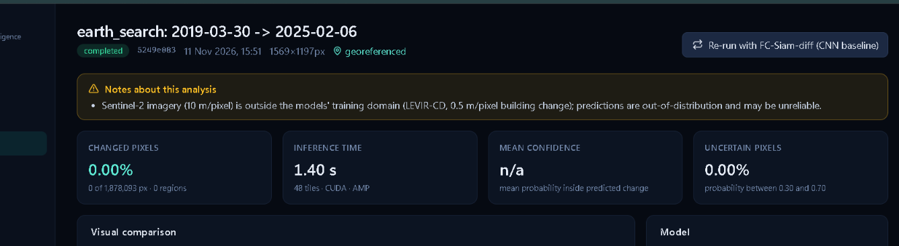
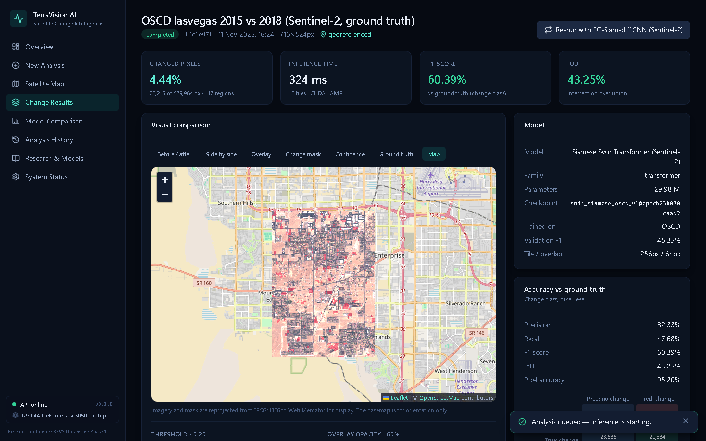

# Testing

## 1. Summary (final recorded runs, 11 November 2026)

| Suite | Tool | Passed | Failed | Coverage | Log |
|---|---|---|---|---|---|
| Backend + ML | pytest, HTTPX TestClient | 161 | 0 | 85% of statements | [`backend_run_final.log`](../evidence/tests/backend_run_final.log) |
| Frontend | Vitest, React Testing Library | 22 | 0 | 58% of lines | [`frontend_vitest.log`](../evidence/tests/frontend_vitest.log) |
| End-to-end | Playwright (Chromium), live backend and trained models | 9 | 0 | - | [`e2e_playwright_final.log`](../evidence/tests/e2e_playwright_final.log) |

Backend tests run on CPU against a temporary database, storage folder and a tiny random-weight checkpoint
that only exercises the plumbing - no accuracy claim is derived from it. End-to-end tests use the real
trained checkpoints and assert real accuracy (for example F1 > 30% on a held-out OSCD city).

## 2. How to run

```powershell
.\.venv\Scripts\python.exe -m pytest --cov                 # backend + ML
cd frontend; npm test                                          # frontend unit tests
npx playwright test                                            # end-to-end (start both servers first)
.\.venv\Scripts\python.exe -m ruff check . ; cd frontend; npm run typecheck; npm run lint
```

## 3. Test-case design (representative cases)

| ID | Type | Feature / requirement | Input | Expected | Actual | Result | Automated test |
|---|---|---|---|---|---|---|---|
| T1 | functional | R1/R5 Upload to results flow | 96x96 PNG pair + mask, threshold 0.4 | 202 with id; status reaches 'completed'; results list model, checkpoint version, statistics, metrics; all artefacts download as 96x96 PNG | As expected | Pass | `test_api::test_upload_inference_results_download_flow` |
| T2 | functional | R4 Metric correctness | Random masks, 4 seeds | Precision, recall, F1, IoU, accuracy and confusion matrix equal scikit-learn | Equal to 1e-12 | Pass | `test_metrics::test_metrics_match_sklearn` |
| T3 | functional | R2 Swin forward pass | 2x3x256x256 tensors | Logits 2x1x256x256, finite; 4-scale pyramid 96/192/384/768 channels | As expected | Pass | `test_models::test_swin_forward_shape_and_parameter_count` |
| T4 | functional | R9 GeoTIFF to georeferenced export | 120x150 UTM 43N GeoTIFF pair | Mask GeoTIFF keeps EPSG:32643, transform and size; changed pixels equal the PNG mask; GeoJSON region count matches | As expected | Pass | `test_api::test_geotiff_upload_prediction_and_georeferenced_exports` |
| T5 | functional | R9 Reprojection | T1 in UTM, T2 in EPSG:4326 covering the same area | T2 reprojected onto the T1 grid with a recorded warning | As expected | Pass | `test_imaging::test_different_crs_is_reprojected_onto_t1` |
| T6 | functional | R6 Geodesic area | Web-Mercator raster at 60 deg N, all pixels changed | Area about 25% of pixel-count x pixel-size (cos^2 60 deg), not the naive value | Within 2% | Pass | `test_geo::test_area_is_geodesic_not_naive_for_web_mercator` |
| T7 | functional | R7 Persistence | Create analysis, restart the application | Analysis, results and artefacts still served | As expected | Pass | `test_api::test_analyses_persist_across_application_restarts` |
| T8 | functional | R11 Train then evaluate | Synthetic dataset, 2 CPU epochs | Loadable trained checkpoint, history.jsonl, config.json, metrics JSON/CSV, charts | As expected | Pass | `test_data_training::test_train_then_evaluate_smoke` |
| T9 | functional | R5/R8 End-to-end in the browser | Bundled LEVIR-CD pair, real Swin checkpoint | Result page shows F1 > 50%, all views, threshold change, downloads, CNN re-run | Pass (F1 on this pair above 90%) | Pass | `e2e/demo.spec.ts::02 sample analysis with ground truth` |
| T10 | boundary | R1 Image side limits | 31 px, 32 px, 1024 px, 1025 px sides (limits 32-1024) | 31 rejected IMAGE_TOO_SMALL; 32 and 1024 accepted; 1025 rejected IMAGE_TOO_LARGE | As expected | Pass | `test_imaging::test_dimension_boundaries` |
| T11 | boundary | R13 Arbitrary raster size | 64x64, 257x100, 300x420, 512x512 inputs | Probability map has exactly the input size, values in [0, 1] | As expected | Pass | `test_models::test_sliding_window_output_matches_input_size` |
| T12 | boundary | R4 Empty mask / no-change pair | Identical images, all-zero ground truth | Completes; warning 'pixel-identical'; recall reported undefined (not 0 or 1); accuracy defined | As expected | Pass | `test_api::test_no_change_pair_completes_with_identical_warning_and_undefined_metrics` |
| T13 | boundary | R5 Threshold limits | Threshold 0, 1, -0.2, 1.5 | 422 VALIDATION_ERROR each | As expected | Pass | `test_api::test_rethreshold_updates_mask_statistics_and_metrics_without_new_inference` |
| T14 | boundary | R1 Oversized upload | 3 MB PNG with a 2 MB limit | 413 FILE_TOO_LARGE | As expected | Pass | `test_api::test_oversized_upload_rejected` |
| T15 | negative | R1 Missing image | Only T1 supplied | 422 MISSING_IMAGE, details.missing = [t2] | As expected | Pass | `test_api::test_missing_image_rejected` |
| T16 | negative | R1 Corrupted image | PNG truncated to 200 bytes | 422 CORRUPTED_IMAGE | As expected | Pass | `test_api::test_corrupted_image_rejected` |
| T17 | negative | R1 Unsupported file | PDF named t2.pdf | 415 UNSUPPORTED_FILE_TYPE | As expected | Pass | `test_api::test_unsupported_file_type_rejected` |
| T18 | negative | R1 Mismatched dimensions | 96x96 vs 128x96 PNG | 422 IMAGE_DIMENSION_MISMATCH | As expected | Pass | `test_api::test_mismatched_dimensions_rejected` |
| T19 | negative | R15 Missing checkpoint | Request Swin with no checkpoint file | 503 MODEL_UNAVAILABLE; nothing stored | As expected | Pass | `test_api::test_missing_checkpoint_gives_model_unavailable_and_stores_nothing` |
| T20 | negative | R9 Invalid CRS | GeoTIFF with a geotransform but no CRS | 422 INVALID_CRS | As expected | Pass | `test_api::test_geotiff_with_transform_but_no_crs_is_rejected` |
| T21 | negative | R9 Rasters of different places | Two UTM GeoTIFFs with no overlap | 422 GEOSPATIAL_MISALIGNMENT | As expected | Pass | `test_api::test_geotiff_pair_covering_different_places_is_rejected` |
| T22 | negative | R13 GPU unavailable | TV_DEVICE=cuda with CUDA reported absent | Service starts, reports device=cpu, analysis completes | As expected | Pass | `test_api::test_requested_gpu_unavailable_falls_back_to_cpu` |
| T23 | negative | R10 Satellite provider failure | Provider returns 500/502/503/429, times out, or returns non-JSON | 502 SATELLITE_PROVIDER_ERROR or 504 ..._TIMEOUT; upstream body never echoed; no analysis created | As expected | Pass | `test_satellite::test_provider_http_failure_maps_to_502 (+ timeout, garbage)` |
| T24 | negative | R12 Inference crash | Model raises during prediction | Analysis marked failed with INFERENCE_FAILED; results endpoint returns 409 ANALYSIS_FAILED | As expected | Pass | `test_api::test_results_of_failed_analysis_return_error` |
| T25 | negative | R14 Path traversal | Analysis ids and artefact names containing ../ | 404, no file access | As expected | Pass | `test_api::test_unknown_and_malformed_analysis_ids` |
| T26 | negative | R12 UI error state | Server rejects the upload | Error banner with message and code; no navigation | As expected | Pass | `app.test.tsx::shows the server validation error when the upload is rejected` |
| T27 | functional | R18 Real Sentinel-2 with ground truth | OSCD Las Vegas test city (never trained on), automatic model choice | Sentinel-2 Swin model selected, no domain warning, F1 > 30%, georeferenced map overlay | Pass (F1 about 60% on this city) | Pass | `e2e/demo.spec.ts::08 real Sentinel-2 test city with ground truth` |
| T28 | functional | R18 Domain-aware model choice | 10 m UTM GeoTIFF pair with and without an explicit LEVIR model | Sentinel-2 model chosen automatically; explicit LEVIR choice honoured but flagged out-of-distribution | As expected | Pass | `test_api::test_sentinel2_model_is_chosen_automatically_for_sentinel2_inputs` |
| T29 | functional | R11 Ignore padded pixels | Tile with 25% padded (ignore=255) pixels, wrong predictions there | Loss identical to the same tile with correct predictions in the padding | As expected | Pass | `test_data_training::test_ignore_pixels_do_not_contribute_to_loss_or_validation_counts` |

## 4. Required negative and boundary cases

| Case | Covered by |
|---|---|
| Missing image | T15 |
| Corrupted image | T16 |
| Unsupported file | T17 |
| Mismatched dimensions | T18 |
| Oversized upload | T14 |
| Missing checkpoint | T19 |
| Invalid CRS | T20 |
| Unavailable GPU | T22 |
| Satellite provider failure | T23 |
| Empty mask | T12, `tests/test_metrics.py` |
| No-change pair | T12 |
| Wrong imagery domain | T28 |

## 5. Integration tests

| Chain | Test |
|---|---|
| Frontend -> API -> GPU inference -> results | e2e 02 (LEVIR-CD), e2e 08 (OSCD with ground truth) |
| Upload -> storage -> retrieval | `test_upload_inference_results_download_flow`, `test_analyses_persist_across_application_restarts` |
| GeoTIFF -> preprocessing -> prediction -> export | `test_geotiff_upload_prediction_and_georeferenced_exports`, e2e 04 |
| Map -> provider -> aligned analysis | `test_retrieve_runs_a_georeferenced_analysis_and_orders_scenes_by_date`, e2e 07 (live search) |
| Training -> checkpoint -> evaluation -> report | `test_train_then_evaluate_smoke`, `test_train_fine_tunes_from_init_checkpoint` |

## 6. Execution history (failures are recorded, not hidden)

| Run | Outcome | Cause | Log |
|---|---|---|---|
| Backend run 1 | 49 passed, 1 failed (stopped) | BUG-003 checkpoint metadata | `evidence/tests/backend_run_01_first_execution.log` |
| Backend run 2 | 153 passed, 1 failed | BUG-005 heuristic threshold | console |
| E2E run 1 | 5 passed, 1 failed, 1 not run | Ambiguous selector (test defect) | `evidence/tests/e2e_playwright_run_01.log` |
| E2E run 2 | 7 passed | - | `evidence/tests/e2e_playwright_run_02.log` |
| Backend after Sentinel-2 models | 150 passed, 5 failed | Tests assumed a 2-model registry; updated | console |
| Backend after OSCD tests | 159 passed, 1 failed | Test defect: round(127.5) is 128 expected | console |
| E2E runs 3-4 | 1 passed, 1 failed, 7 not run | Tests assumed 2 models (test defects) | `evidence/tests/e2e_playwright_run_03.log`, `_04.log` |
| E2E run 5 | 9 passed | Stale-screenshot wait fixed | `evidence/tests/e2e_playwright_run_05.log` |
| **Backend final** | **161 passed** | - | `evidence/tests/backend_run_final.log`, `backend_junit.xml` |
| **Frontend final** | **22 passed** | - | `evidence/tests/frontend_vitest.log` |
| **E2E final** | **9 passed** | - | `evidence/tests/e2e_playwright_final.log` |

## 7. Bug register and root-cause analysis

| ID | Symptom | Root cause | Fix | Before / after evidence |
|---|---|---|---|---|
| BUG-001 | Training crashed at start-up with JSONDecodeError on the CNN config file. | The config had been rewritten by Windows PowerShell, which adds a UTF-8 byte-order mark; json.loads on text read as plain UTF-8 rejects the BOM. | Config files are read with encoding='utf-8-sig' (ml/train.py; same for the sample manifest). Regression test writes a BOM-prefixed config. | Before: evidence/bugs/BUG-001_before_config_bom_traceback.log. After: test_data_training::test_train_cli_rejects_unknown_config_keys passes with a BOM config. |
| BUG-002 | The CNN baseline predicted 'no change' for every pixel: validation F1 stayed at 0.0000 for four epochs while the loss barely moved. | Dice loss was computed per tile. About 55% of tiles have no change, and for an empty tile the per-tile Dice term is about 1 for any non-zero probability mass, so those tiles dominated the gradient and pushed all outputs to zero. | Dice is computed over the whole batch (ml/losses.py). Confirmed with an overfit diagnostic before retraining; both models were retrained from scratch so the comparison stays fair. | Before: evidence/bugs/BUG-002_before/ (v1 history: F1 = 0 for epochs 1-4). After: evidence/bugs/BUG-002_after/ (v2 history: F1 0.39 at epoch 1, 0.69 by epoch 6). |
| BUG-003 | A checkpoint written by the real training script could not be loaded: 'Weights only load failed ... Unsupported global: torch.torch_version.TorchVersion'. | torch.__version__ is a TorchVersion object, not a str; it was stored in the checkpoint metadata, and the safe weights_only unpickler refuses unknown classes. Found by the train-then-evaluate test before the application ever used a real checkpoint. | The version is stored as str(); the loader allow-lists TorchVersion and normalises metadata (ml/train.py, ml/checkpoint.py). | Before: evidence/bugs/BUG-003_before_checkpoint_torchversion.log (1 failed, 49 passed). After: evidence/tests/backend_run_final.log (155 passed). |
| BUG-004 | A backend started while training was still running kept serving the Swin weights from epoch 18 after training had saved the final epoch-29 checkpoint under the same file name. | ModelManager cached a loaded model for the life of the process and never checked whether the checkpoint file had been replaced, so results silently came from stale weights that did not match the benchmark. | The cache records the file's modification time and reloads when it changes (backend/app/services/model_manager.py). | Before: evidence/bugs/BUG-004/before_stale_epoch18_checkpoint_served.jpg. After: evidence/bugs/BUG-004/after_final_epoch29_checkpoint_served.png and test_api::test_replaced_checkpoint_is_reloaded_instead_of_serving_stale_weights. |
| BUG-005 | The 'these images may show different places' warning scored a genuinely related pair below its threshold (edge correlation 0.14 with a 0.15 threshold). | The threshold was a guess. Measured on 40 LEVIR-CD test pairs, genuine pairs score median 0.47 (5th percentile 0.16) and deliberately mismatched pairs median -0.03 (95th percentile 0.15), so 0.15 sat inside the genuine range. | Threshold calibrated to 0.10 from those measurements, the warning text now states it is a heuristic, and the test uses realistic edge-rich scenes (backend/app/services/imaging.py). | Before: first full run 153 passed / 1 failed. After: evidence/tests/backend_run_final.log. |
| BUG-006 | Real Sentinel-2 imagery gave no output: the north-Bengaluru map analysis reported 0.00% changed pixels, 0 regions (reported by the user). | Domain shift, not a code fault: the only models were trained on 0.5 m LEVIR-CD aerial imagery, where a building spans dozens of pixels; at 10 m it spans one or two. Measured on the OSCD test cities, the LEVIR-only Swin model reaches F1 0.0%. The app ran such a model on Sentinel-2 and only printed a warning. | Added Sentinel-2 models fine-tuned on OSCD with TCI-matched radiometry (ml/data/oscd.py), a validation-selected threshold (ml/calibrate.py), automatic model choice by imagery domain and a domain-mismatch warning (backend/app/services/model_manager.py), and a cross-domain benchmark. | Before: evidence/bugs/BUG-006/before_levir_model_0pct_on_sentinel2.png. After: evidence/bugs/BUG-006/after_sentinel2_model_on_bengaluru.png (detections; no ground truth available) and after_oscd_lasvegas_measured.png (held-out city with ground truth, measured F1). |

Evidence files: [`evidence/bugs/`](../evidence/bugs).

| BUG-006 before (LEVIR model on Sentinel-2) | BUG-006 after (Sentinel-2 model, held-out city with ground truth) |
|---|---|
|  |  |

## 8. Complete test catalogue

### `tests/test_api.py` (45)

| Test | Notes |
|---|---|
| `test_health_reports_ok_with_database_and_model` |  |
| `test_system_reports_cpu_device_and_storage` |  |
| `test_models_lists_availability_and_reason_for_missing_checkpoint` |  |
| `test_config_exposes_limits_but_no_paths_or_secrets` |  |
| `test_unknown_route_uses_error_envelope` |  |
| `test_security_and_request_id_headers` |  |
| `test_cors_allows_only_configured_origin` |  |
| `test_upload_inference_results_download_flow` |  |
| `test_results_without_ground_truth_have_no_accuracy_metrics` |  |
| `test_non_georeferenced_analysis_refuses_geotiff_export` |  |
| `test_no_change_pair_completes_with_identical_warning_and_undefined_metrics` |  |
| `test_rethreshold_updates_mask_statistics_and_metrics_without_new_inference` |  |
| `test_geotiff_upload_prediction_and_georeferenced_exports` |  |
| `test_geotiff_pair_on_different_grids_is_aligned_with_warning` |  |
| `test_geotiff_pair_covering_different_places_is_rejected` |  |
| `test_geotiff_with_transform_but_no_crs_is_rejected` |  |
| `test_missing_image_rejected` |  |
| `test_corrupted_image_rejected` |  |
| `test_unsupported_file_type_rejected` |  |
| `test_mismatched_dimensions_rejected` |  |
| `test_mask_with_wrong_dimensions_rejected` |  |
| `test_oversized_upload_rejected` |  |
| `test_image_side_boundaries` |  |
| `test_unknown_model_rejected` |  |
| `test_missing_checkpoint_gives_model_unavailable_and_stores_nothing` |  |
| `test_invalid_threshold_rejected` |  |
| `test_unknown_and_malformed_analysis_ids` |  |
| `test_unknown_artifact_rejected` |  |
| `test_results_of_failed_analysis_return_error` |  |
| `test_requested_gpu_unavailable_falls_back_to_cpu` |  |
| `test_samples_are_listed_with_provenance` |  |
| `test_sample_analysis_and_rerun` |  |
| `test_create_analysis_validation` |  |
| `test_evaluation_on_labelled_samples_and_summary` |  |
| `test_evaluation_rejects_unlabelled_selection_and_missing_models` |  |
| `test_benchmark_summary_is_served_when_report_exists` |  |
| `test_history_pagination_filter_stats_and_delete` |  |
| `test_analyses_persist_across_application_restarts` |  |
| `test_interrupted_jobs_are_failed_and_orphan_folders_removed_on_startup` |  |
| `test_model_is_loaded_once_and_reused` |  |
| `test_swin_checkpoint_becomes_available_when_file_appears` |  |
| `test_provider_transport_is_not_used_by_core_workflow` |  |
| `test_sentinel2_model_is_chosen_automatically_for_sentinel2_inputs` | With a Sentinel-2 checkpoint present, 10 m GeoTIFFs and Sentinel-2 samples default to it - no warning. |
| `test_replaced_checkpoint_is_reloaded_instead_of_serving_stale_weights` | BUG-004: a backend started during training kept serving the checkpoint it loaded first. |
| `test_checkpoint_threshold_is_the_default_and_explicit_threshold_wins` | Checkpoints carry a validation-selected threshold (ml.calibrate); it is used unless the user sets one. |
### `tests/test_data_training.py` (13)

| Test | Notes |
|---|---|
| `test_tile_cuts_non_overlapping_patches_in_row_major_order` |  |
| `test_prepare_writes_memmaps_and_manifest` |  |
| `test_prepare_detects_unpaired_files_missing_folders_and_leakage` |  |
| `test_missing_processed_dataset_gives_actionable_error` |  |
| `test_normalize_uses_imagenet_statistics` |  |
| `test_augmentation_keeps_images_and_mask_geometrically_consistent` |  |
| `test_safe_extract_blocks_path_traversal` |  |
| `test_train_then_evaluate_smoke` | One CPU epoch on synthetic data must produce a loadable trained checkpoint, logs and reports. |
| `test_train_cli_rejects_unknown_config_keys` |  |
| `test_oscd_tiles_pad_small_images_and_mark_padding_as_ignore` |  |
| `test_oscd_rgb_gain_matches_measured_tci_scale` | DN 2500 maps to 255, as measured on Earth Search TCI (reports/tci_gain_fit.json). |
| `test_ignore_pixels_do_not_contribute_to_loss_or_validation_counts` |  |
| `test_train_fine_tunes_from_init_checkpoint` |  |
### `tests/test_geo.py` (12)

| Test | Notes |
|---|---|
| `test_geotiff_roundtrip_preserves_crs_transform_and_values` |  |
| `test_multiband_geotiff` |  |
| `test_change_regions_area_matches_pixel_area_in_utm` |  |
| `test_change_regions_are_wgs84_lon_lat` |  |
| `test_area_is_geodesic_not_naive_for_web_mercator` |  |
| `test_empty_mask_yields_no_regions` |  |
| `test_footprint_area` |  |
| `test_web_mercator_overlay_bounds_and_image` |  |
| `test_threshold_rule_and_statistics` |  |
| `test_statistics_for_empty_mask` |  |
| `test_build_outputs_without_geo_or_truth_reports_no_metrics` |  |
| `test_build_outputs_with_geo_and_truth` |  |
### `tests/test_imaging.py` (25)

| Test | Notes |
|---|---|
| `test_png_and_jpeg_decode_to_rgb_uint8` |  |
| `test_grayscale_and_rgba_are_converted_with_a_note` |  |
| `test_unsupported_extension_rejected` |  |
| `test_extension_must_match_content` |  |
| `test_empty_file_rejected` |  |
| `test_truncated_png_rejected` |  |
| `test_garbage_with_valid_magic_rejected` |  |
| `test_dimension_boundaries` |  |
| `test_geotiff_keeps_crs_transform_and_bounds` |  |
| `test_plain_tiff_without_georeferencing_is_accepted_as_image` |  |
| `test_transform_without_crs_is_invalid_crs` |  |
| `test_uint16_raster_is_stretched_to_8bit` |  |
| `test_single_band_raster_replicated` |  |
| `test_two_band_raster_rejected` |  |
| `test_mismatched_dimensions_rejected_for_plain_images` |  |
| `test_identical_grids_pass_through_untouched` |  |
| `test_same_crs_shifted_grid_is_resampled_onto_t1` |  |
| `test_different_crs_is_reprojected_onto_t1` |  |
| `test_non_overlapping_rasters_rejected` |  |
| `test_partially_overlapping_rasters_rejected` |  |
| `test_one_georeferenced_image_emits_warning_and_shares_geo` |  |
| `test_mask_loading_binarises_0_255_and_0_1` |  |
| `test_mask_dimension_mismatch_rejected` |  |
| `test_related_pair_has_high_structural_correlation_unrelated_low` |  |
| `test_sanity_warnings_flag_identical_unrelated_and_blank_images` |  |
### `tests/test_metrics.py` (9)

| Test | Notes |
|---|---|
| `test_metrics_match_sklearn` |  |
| `test_hand_computed_example` |  |
| `test_perfect_prediction` |  |
| `test_empty_prediction_makes_precision_undefined_not_zero` |  |
| `test_empty_ground_truth_makes_recall_undefined` |  |
| `test_no_change_pair_all_change_metrics_undefined_accuracy_one` |  |
| `test_zero_pixels_everything_undefined` |  |
| `test_shape_mismatch_raises` |  |
| `test_counts_accumulate_and_add` |  |
### `tests/test_models.py` (21)

| Test | Notes |
|---|---|
| `test_registry_lists_transformer_and_cnn` |  |
| `test_swin_forward_shape_and_parameter_count` |  |
| `test_swin_encoder_is_shared_and_pyramid_has_four_scales` |  |
| `test_swin_rejects_wrong_tile_size_and_mismatched_inputs` |  |
| `test_swin_identical_inputs_still_produce_valid_logits` |  |
| `test_fc_siam_diff_forward_any_size` |  |
| `test_fc_siam_diff_is_symmetric_in_time_for_difference_skips` |  |
| `test_loss_is_finite_decreases_and_handles_empty_targets` |  |
| `test_loss_gradient_flows` |  |
| `test_checkpoint_roundtrip` |  |
| `test_missing_checkpoint_raises` |  |
| `test_corrupt_checkpoint_raises` |  |
| `test_foreign_checkpoint_without_metadata_is_rejected` |  |
| `test_untrained_checkpoint_is_rejected` |  |
| `test_checkpoint_for_other_model_is_rejected` |  |
| `test_architecture_mismatch_is_rejected` |  |
| `test_sliding_window_output_matches_input_size` |  |
| `test_tile_positions_cover_image_exactly` |  |
| `test_inference_is_deterministic` |  |
| `test_inference_input_validation` |  |
| `test_resolve_device_falls_back_to_cpu_without_cuda` |  |
### `tests/test_satellite.py` (17)

| Test | Notes |
|---|---|
| `test_bbox_helpers` |  |
| `test_aoi_coverage_full_partial_and_missing_geometry` |  |
| `test_providers_endpoint_reports_configuration` |  |
| `test_search_parses_ranks_and_sends_a_correct_stac_query` |  |
| `test_search_with_no_matches_returns_empty_list` |  |
| `test_provider_http_failure_maps_to_502` |  |
| `test_provider_timeout_maps_to_504` |  |
| `test_provider_network_failure_and_garbage_response` |  |
| `test_search_request_validation` |  |
| `test_retrieve_rejects_scene_with_partial_coverage_or_foreign_asset_host` |  |
| `test_cdse_search_works_without_credentials_but_retrieve_requires_them` |  |
| `test_cdse_token_and_process_request_follow_documented_api` |  |
| `test_retrieve_validation` |  |
| `test_retrieve_runs_a_georeferenced_analysis_and_orders_scenes_by_date` | Map workflow end-to-end with the remote imagery replaced by synthetic georeferenced rasters. |
| `test_provider_failure_during_retrieve_creates_no_analysis` |  |
| `test_geocode_parses_results_and_handles_failure` |  |
| `test_search_query_dataclass_defaults` |  |
### `frontend/src/test/app.test.tsx` (22)

| Test | Notes |
|---|---|
| `renders missing values as n/a instead of inventing numbers` |  |
| `builds artefact urls` |  |
| `estimates AOI size` |  |
| `maps the backend error envelope to ApiError` |  |
| `reports an unreachable backend as NETWORK_ERROR` |  |
| `validates files before upload` |  |
| `FileDrop rejects an unsupported file and shows the reason` |  |
| `ModelSelect disables models without a trained checkpoint` |  |
| `CompareSlider moves the reveal position` |  |
| `ErrorBanner shows message, code and retry` |  |
| `shows live statistics on the overview and navigates through the sidebar` |  |
| `shows empty states when nothing has been run` |  |
| `shows an error state with retry when the backend is down` |  |
| `renders a not-found page for unknown routes` |  |
| `uploads a pair, then shows results without accuracy metrics when no ground truth exists` |  |
| `sends the chosen model and threshold when automatic selection is turned off` |  |
| `shows the server validation error when the upload is rejected` |  |
| `starts an analysis from a bundled sample` |  |
| `shows metrics and the confusion matrix when ground truth exists` |  |
| `shows the failure reason for a failed analysis` |  |
| `shows progress while the analysis is running` |  |
| `shows not-found for an unknown analysis` |  |
### `frontend/e2e/demo.spec.ts` (9)

| Test | Notes |
|---|---|
| `01 backend health and system status` |  |
| `02 sample analysis with ground truth: Swin transformer` |  |
| `03 model comparison shows the real benchmark and live sample evaluation` |  |
| `04 manual upload of a GeoTIFF pair gives georeferenced results on the map` |  |
| `05 error handling: mismatched image sizes are rejected with a clear message` |  |
| `06 history, overview and research pages reflect real state` |  |
| `07 satellite map: live Sentinel-2 search (online only)` |  |
| `08 real Sentinel-2 test city with ground truth: OSCD-trained transformer on the map` |  |
| `09 Bengaluru Sentinel-2 pair now produces detections with the Sentinel-2 model` |  |

## 9. Not tested

- Copernicus Data Space (CDSE) retrieval against the real service (no credentials).
- Docker build and run (Docker not installed on the development machine).
- Load, concurrency, security penetration and long-running reliability.
- Browsers other than Chromium; mobile devices.
